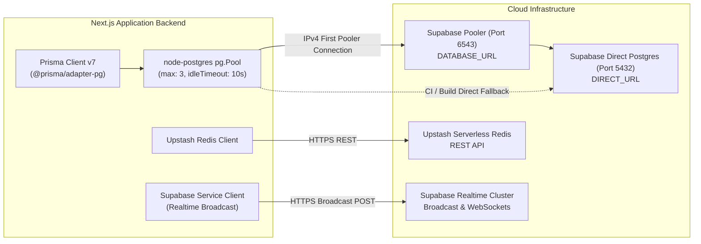
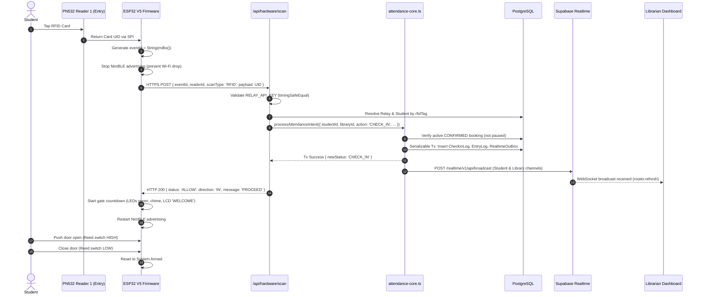
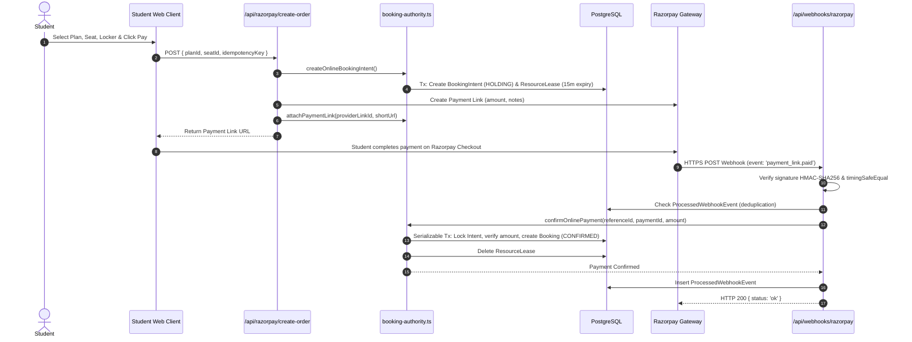
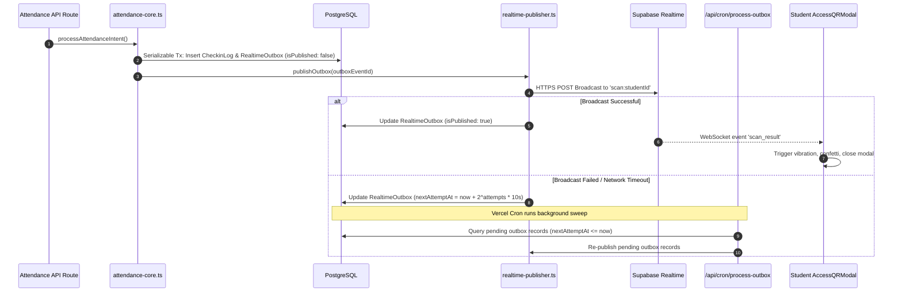

# FOCUSDESK — COMPREHENSIVE READ-ONLY CODEBASE AUDIT REPORT

**Date of Audit:** October 13, 2026  
**Auditor:** Principal Software Architect, Senior Full-Stack Engineer, IoT Systems Architect, and Codebase Auditor  
**Audit Scope:** Repository `focusx` (`c:\Users\ASUS\OneDrive\Documents\FOCUS DESK INTERN\focusx`)  
**Audit Methodology:** Strict Read-Only Static Source Code Inspection (Zero Code Execution, Zero File Modifications)  
**Evidence Baseline:** All line numbers, symbol names, file paths, and schemas are extracted directly from active repository source files. Runtime functionality is classified as **UNVERIFIED** pursuant to Section 1.3 of the audit instructions.

---

# REPORT 1 — Executive Summary

### 1.1 Overall Architecture
The FOCUSDESK codebase is a hybrid Next.js 16 (React 19) full-stack web application integrated with Supabase PostgreSQL, Upstash Redis, Firebase Auth, Razorpay, Cashfree DigiLocker KYC, and custom ESP32 IoT access-control hardware.

The core system is structured around three primary planes:
1. **The Client Plane:** A Next.js responsive web application supporting four user roles: Students (`/student`, `/(student)`), Librarians (`/dashboard`), Receptionists (scoped `/dashboard`), and Superadmins (`/admin`). Mobile-specific REST endpoints (`/api/mobile/*`) also exist for an external mobile client.
2. **The Business Authority Plane:** A centralized domain layer centered on `src/lib/booking-authority.ts` (58 KB) and `src/lib/attendance-core.ts` executing atomic database transactions (Prisma v7 with PostgreSQL driver adapter and connection pooling) with double-booking prevention, temporary lease holding, and a transactional outbox (`RealtimeOutbox`).
3. **The Physical Access Control Plane:** Multiple evolutionary generations of ESP32 and NodeMCU C++/Arduino firmware. The latest active iteration (`FocusX_Scanner_Firmware_V5_DualRFID.ino`) runs FreeRTOS dual-core tasks managing two SPI-connected PN532 RFID readers (Entry/Exit), a magnetic door reed sensor, two NeoPixel LED strips, an I2C LCD, a buzzer, and NimBLE (Bluetooth Low Energy) GATT and iBeacon broadcast.

### 1.2 Confirmed Technology Stack
- **Full-Stack Framework:** Next.js 16.2.7 (React 19.2.4) using App Router, Server Actions, and Route Handlers.
- **ORM & Database:** Prisma 7.8.0 / `@prisma/client: ^7.10.0` with `@prisma/adapter-pg: ^7.8.0` and `pg.Pool` connected to hosted Supabase PostgreSQL (pooling via port 6543 Supavisor, direct port 5432).
- **Identity & Authentication:** **Firebase Auth** (Phone OTP with client SDK `firebase: ^12.14.0` and server SDK `firebase-admin: 11.11.1`). Session management uses 14-day HTTP-only Firebase session cookies with Redis-backed revocation sets. Supabase Auth is **NOT** used for user identity; a bridge endpoint (`/api/auth/supabase-token`) mints custom JWTs for Supabase Realtime client connections.
- **Realtime Infrastructure:** Supabase Realtime Broadcast REST API (`src/lib/realtime-publisher.ts`) and client WebSocket subscriptions (`postgres_changes` on `EntryLog`, private broadcast on `scan:<studentId>`).
- **Caching & Rate Limiting:** Upstash Redis (`@upstash/redis: ^1.38.0`, `@upstash/ratelimit: ^2.0.8`) for route-level sliding-window rate limiting, session caching, and read-through caching.
- **Payment Processing:** **Razorpay** (`razorpay: ^2.9.6`) with Payment Links, Razorpay Route split accounts, idempotent refunds (`src/lib/refund-worker.ts`), and signed webhook ingestion. Cashfree is present but **strictly restricted to DigiLocker Aadhaar KYC verification** (`src/lib/cashfree.ts`).
- **Storage & Assets:** ImageKit (`imagekit: ^6.0.0`, `imagekitio-next: ^1.0.1`) for CDN-hosted profile photos, passbook images, and library galleries. Supabase Storage is **NOT** implemented.
- **Hardware & Firmware:** ESP32 (WROOM-32) running FreeRTOS Arduino firmware (`FocusX_Scanner_Firmware_V5_DualRFID.ino`), dual Adafruit PN532 RFID readers, NimBLE BLE, GM67 optical QR module (in V4 and `esp32_qr_access`), and LiquidCrystal_I2C.

### 1.3 Major Functional Modules
1. **Authoritative Booking & Lease Engine:** Two-phase commit with 15-minute `ResourceLease` records, preventing concurrent double-bookings before online payment or librarian confirmation.
2. **Attendance & Access Core:** Strict toggle or explicit direction handling, idempotency checks via unique `eventId`, and physical relay state tracking.
3. **Transactional Outbox & Realtime Broadcaster:** `RealtimeOutbox` model committed within the attendance transaction and replayed via Vercel Cron.
4. **Automated Rule Engine:** `LibraryRule` and `RuleExecution` engine evaluating conditions (overstay, booking expiry, absence) with IST calendar cooldowns.
5. **Refund Queue Worker:** Database-backed queue (`RefundTask`) with PostgreSQL `FOR UPDATE SKIP LOCKED` locking, exponential backoff, and Razorpay API reconciliation.
6. **Digital Pass & Web Bluetooth Unlock:** Web client generating dynamic signed QR passes and triggering door relays directly via Web Bluetooth API (`BluetoothUnlockButton.tsx`).

### 1.4 Strongest Existing Implementations
- **Payment & Booking Concurrency (`src/lib/booking-authority.ts`):** Extremely robust isolation semantics with `Prisma.$transaction` at `Serializable` isolation, preventing double bookings, orphaned seats, and unpaid hold expirations.
- **Idempotent Webhook Processing (`src/app/api/webhooks/razorpay/route.ts`):** Full cryptographic SHA-256 HMAC verification, timing-safe equality, payload hashing, and duplicate rejection via `ProcessedWebhookEvent`.
- **Durable Refund Worker (`src/lib/refund-worker.ts`):** Enterprise-grade queue worker utilizing PostgreSQL row-level locks (`FOR UPDATE SKIP LOCKED`) and timeout recovery.

### 1.5 Most Significant Implementation Gaps & Static Risks
- **Hardware Authorization is 100% Online in V5:** The active V5 DualRFID firmware does **NOT** perform local offline authorization. Every card tap executes a synchronous blocking HTTPS POST to the Next.js API. If internet or Wi-Fi drops, door access fails completely.
- **Event IDs are Non-Persistent in V5 Firmware:** `eventId` is generated as `String(millis())`, resetting to zero upon device reboot, creating risk of ID collision across reboots.
- **Hardcoded Secrets in Firmware:** Production firmware contains hardcoded API keys (`"my_secret_library_door_key_123"`), hardcoded Supabase Anon JWTs, and disables TLS certificate validation (`client.setInsecure()`).
- **Web Bluetooth Endpoint Mismatch:** `BluetoothUnlockButton.tsx` (line 49) fires a GET request to `/api/mobile/attendance/ble` which only reads reader metadata; it fails to record actual attendance because attendance recording requires a POST request.
- **Repository File Sprawl:** Over 100 scratch/debugging Python, TypeScript, and shell scripts sit in the repository root alongside five competing firmware versions.

### 1.6 Important Unknowns
- Deployed production database state and active Supabase RLS policy deployment.
- Physical relay operational status in live libraries.
- Mobile client repository status (mobile API routes exist, but no mobile client codebase is in this repository).

---

# REPORT 2 — Repository Structure

```
focusx/
├── .agents/                               # Custom agent instructions and Clerk router skills
├── .gitignore, .npmrc, .vercelignore      # Project level package and deployment ignores
├── AGENTS.md, CLAUDE.md, README.md        # AI rules and baseline documentation
├── FocusX_Scanner_Firmware/               # Historical ESP32 scanner firmware (V1)
├── FocusX_Scanner_Firmware_V2/            # Historical ESP32 scanner firmware (V2)
├── FocusX_Scanner_Firmware_V3/            # Historical ESP32 scanner firmware (V3)
├── FocusX_Scanner_Firmware_V4/            # Historical ESP32 scanner firmware (V4: ToF sensor + Supabase Realtime)
├── FocusX_Scanner_Firmware_V5_DualRFID/   # ACTIVE: Dual-RFID ESP32 FreeRTOS firmware with NimBLE
├── esp32_qr_access/                       # Alternative modular firmware: GM67 QR + offline ECDSA + LittleFS
├── nodemcu_qr_access/                     # Legacy ESP8266 NodeMCU QR scanner firmware
├── ble_only_logic/                        # Experimental BLE GATT access firmware
├── rfid_only_logic/                       # Experimental RFID NVS-cached access firmware
├── current.ino, extracted.ino             # Scratch firmware files in root
├── docs/                                  # Architectural specifications and legacy PRDs
│   ├── architecture/                      # System maps, data models, workflows, uncertainties
│   └── prd/                               # Legacy requirements and FULL_PRD.md
├── prisma/                                # Database definitions and migrations
│   ├── migrations/                        # 6 SQL migration directories
│   ├── schema.prisma                      # Authoritative Prisma schema (24 models)
│   └── seed.ts                            # Database seeding script
├── public/                                # Static web assets (logos, badges, icons)
├── scripts/                               # Maintenance and deployment migration utilities
├── src/                                   # Next.js 16 Application Root
│   ├── app/                               # Next.js App Router
│   │   ├── (student)/                     # Public directory, discovery, student portal & profile
│   │   ├── actions/                       # 17 Next.js Server Action modules
│   │   ├── admin/                         # Superadmin approval & management interface
│   │   ├── api/                           # 19 Route Handler subdirectories (59 endpoints)
│   │   ├── auth/                          # Authentication restoration routes
│   │   ├── blog/                          # Sanity CMS blog dynamic pages
│   │   ├── dashboard/                     # Librarian & Receptionist dashboard
│   │   ├── login/, signup/, sso/          # Authentication entry pages
│   │   ├── onboarding/                    # Library partner onboarding application
│   │   └── studio/                        # Sanity Studio embedded CMS route
│   ├── components/                        # UI component library (Shadcn UI, Modals, Forms)
│   ├── hooks/                             # React custom hooks
│   ├── lib/                               # Core backend engines, utilities, clients
│   │   ├── booking-engine/                # Booking policy, evaluation, and pricing rules
│   │   ├── firebase/                      # Firebase Client and Admin SDK initializations
│   │   ├── booking-authority.ts           # Central booking lifecycle and lease authority
│   │   ├── attendance-core.ts             # Authoritative attendance transaction logic
│   │   ├── rule-engine.ts                 # Automated library rule engine
│   │   ├── refund-worker.ts               # Background refund reconciliation worker
│   │   ├── realtime-publisher.ts          # Supabase Realtime Broadcast publisher
│   │   └── ...                            # Redis, Razorpay, Cashfree, ImageKit adapters
│   └── middleware.ts                      # Edge middleware (Rate limiting, CSRF, Session rewrite)
├── tests/                                 # Static test suites (Integration & Acceptance)
├── package.json, tsconfig.json            # Node.js project manifest & TypeScript config
├── next.config.ts                         # Next.js build, CSP, CORS, remote patterns config
├── vercel.json                            # Vercel deployment & cron job configuration
└── [300+ root scratch scripts]            # Ad-hoc Python/TS/JS scripts used during dev/debugging
```

### Detailed Repository Inventory

| Directory / File | Purpose | Main Technologies | Current Relevance | Evidence |
|---|---|---|---|---|
| `src/app/(student)/` | Student public discovery, booking, profile, and digital pass | Next.js, React 19, Tailwind CSS | **ACTIVE** | [page.tsx](file:///c:/Users/ASUS/OneDrive/Documents/FOCUS%20DESK%20INTERN/focusx/src/app/(student)/student/dashboard/page.tsx:1-60) |
| `src/app/dashboard/` | Librarian & Receptionist management dashboard | React 19, Recharts, Server Actions | **ACTIVE** | [layout.tsx](file:///c:/Users/ASUS/OneDrive/Documents/FOCUS%20DESK%20INTERN/focusx/src/app/dashboard/layout.tsx:1-100) |
| `src/app/admin/` | Superadmin platform library verification | Server Actions, Prisma | **ACTIVE** | [page.tsx](file:///c:/Users/ASUS/OneDrive/Documents/FOCUS%20DESK%20INTERN/focusx/src/app/admin/page.tsx:1-100) |
| `src/app/api/` | REST API route handlers (mobile, hardware, cron, webhooks) | Next.js Route Handlers | **ACTIVE** | 59 endpoints in `src/app/api/` |
| `src/app/actions/` | Next.js Server Actions for mutations | React 19 Server Actions, Prisma | **ACTIVE** | 17 action files in `src/app/actions/` |
| `src/lib/` | Domain engines, authority layer, external clients | TypeScript, Prisma, Redis, Crypto | **ACTIVE** | 31 modules in `src/lib/` |
| `FocusX_Scanner_Firmware_V5_DualRFID/` | Deployed dual-reader RFID/BLE firmware | ESP32, FreeRTOS, NimBLE, PN532 | **ACTIVE** | [FocusX_Scanner_Firmware_V5_DualRFID.ino](file:///c:/Users/ASUS/OneDrive/Documents/FOCUS%20DESK%20INTERN/focusx/FocusX_Scanner_Firmware_V5_DualRFID/FocusX_Scanner_Firmware_V5_DualRFID.ino:1-150) |
| `FocusX_Scanner_Firmware_V1..V4` | Historical iterations of scanner firmware | ESP32, Arduino C++ | **SUPERSEDED** | Replaced by V5 DualRFID |
| `esp32_qr_access/` | GM67 optical QR + offline ECDSA firmware | ESP32, mbedtls, LittleFS | **ALTERNATIVE / INACTIVE** | Not linked to active V5 scanner |
| `nodemcu_qr_access/` | NodeMCU ESP8266 scanner firmware | ESP8266, LittleFS | **LEGACY / RETIRED** | ESP8266 hardware platform |
| `ble_only_logic/`, `rfid_only_logic/` | Isolated POCs for BLE & NVS RFID caching | ESP32, Preferences (NVS) | **EXPERIMENTAL** | Standalone test sketches |
| `prisma/` | Schema, migrations, and seeding | Prisma 7.8.0, PostgreSQL | **ACTIVE** | [schema.prisma](file:///c:/Users/ASUS/OneDrive/Documents/FOCUS%20DESK%20INTERN/focusx/prisma/schema.prisma:1-150) |
| `tests/` | Booking authority and hardware acceptance tests | Node test runner, tsx | **ACTIVE** | [tests/](file:///c:/Users/ASUS/OneDrive/Documents/FOCUS%20DESK%20INTERN/focusx/tests) |
| `vercel.json` | Vercel region and background cron configuration | JSON | **ACTIVE** | [vercel.json](file:///c:/Users/ASUS/OneDrive/Documents/FOCUS%20DESK%20INTERN/focusx/vercel.json:1-16) |
| `root/*.py, *.js, *.ts` | 100+ ad-hoc dev scripts (`add_*.py`, `check_*.js`, etc.) | Python, JS, TS | **SCRATCH / OBSOLETE** | Leftover development artifacts |

---

# REPORT 3 — Technology Stack Inventory

| Layer | Technology | Declared Version | Actively Used? | Implementation Status | Evidence |
|---|---|---|---|---|---|
| **Frontend Framework** | Next.js | `16.2.7` | Yes | IMPLEMENTED (STATICALLY VERIFIED) | [package.json:48](file:///c:/Users/ASUS/OneDrive/Documents/FOCUS%20DESK%20INTERN/focusx/package.json:48) |
| **UI Runtime** | React / React DOM | `19.2.4` | Yes | IMPLEMENTED (STATICALLY VERIFIED) | [package.json:53-54](file:///c:/Users/ASUS/OneDrive/Documents/FOCUS%20DESK%20INTERN/focusx/package.json:53-54) |
| **Styling** | Tailwind CSS v4 | `^4` (`@tailwindcss/postcss: ^4`) | Yes | IMPLEMENTED (STATICALLY VERIFIED) | [package.json:71, 83](file:///c:/Users/ASUS/OneDrive/Documents/FOCUS%20DESK%20INTERN/focusx/package.json:71), [globals.css](file:///c:/Users/ASUS/OneDrive/Documents/FOCUS%20DESK%20INTERN/focusx/src/app/globals.css) |
| **ORM** | Prisma Client | `^7.10.0` / CLI `^7.8.0` | Yes | IMPLEMENTED (STATICALLY VERIFIED) | [prisma.ts:36](file:///c:/Users/ASUS/OneDrive/Documents/FOCUS%20DESK%20INTERN/focusx/src/lib/prisma.ts:36) |
| **DB Driver Adapter** | `@prisma/adapter-pg` + `pg` | `7.8.0` / `8.23.1` | Yes | IMPLEMENTED (STATICALLY VERIFIED) | [prisma.ts:2-34](file:///c:/Users/ASUS/OneDrive/Documents/FOCUS%20DESK%20INTERN/focusx/src/lib/prisma.ts:2-34) |
| **Primary Database** | Hosted PostgreSQL (Supabase) | N/A | Yes | IMPLEMENTED (STATICALLY VERIFIED) | [schema.prisma:5-7](file:///c:/Users/ASUS/OneDrive/Documents/FOCUS%20DESK%20INTERN/focusx/prisma/schema.prisma:5-7) |
| **User Identity** | Firebase Auth (Client & Admin) | `12.14.0` / `11.11.1` | Yes | IMPLEMENTED (STATICALLY VERIFIED) | [auth-actions.ts:6-124](file:///c:/Users/ASUS/OneDrive/Documents/FOCUS%20DESK%20INTERN/focusx/src/app/actions/auth-actions.ts:6-124) |
| **Supabase Auth** | Supabase GoTrue | N/A | **No** | LEGACY / SUPERSEDED (Firebase active) | Replaced by Firebase Auth; bridge JWT only |
| **Supabase Realtime** | Realtime Broadcast & Postgres Changes | `@supabase/supabase-js: ^2.113.0` | Yes | IMPLEMENTED (STATICALLY VERIFIED) | [realtime-publisher.ts:25](file:///c:/Users/ASUS/OneDrive/Documents/FOCUS%20DESK%20INTERN/focusx/src/lib/realtime-publisher.ts:25) |
| **Supabase Storage** | Supabase Storage S3/Buckets | N/A | **No** | NOT FOUND | 0 references in source code |
| **Distributed Cache** | Upstash Redis | `@upstash/redis: ^1.38.0` | Yes | IMPLEMENTED (STATICALLY VERIFIED) | [redis.ts:8-11](file:///c:/Users/ASUS/OneDrive/Documents/FOCUS%20DESK%20INTERN/focusx/src/lib/redis.ts:8-11) |
| **Rate Limiter** | Upstash Ratelimit | `@upstash/ratelimit: ^2.0.8` | Yes | IMPLEMENTED (STATICALLY VERIFIED) | [rate-limit.ts:8-27](file:///c:/Users/ASUS/OneDrive/Documents/FOCUS%20DESK%20INTERN/focusx/src/lib/rate-limit.ts:8-27) |
| **Payments** | Razorpay Node SDK | `^2.9.6` | Yes | IMPLEMENTED (STATICALLY VERIFIED) | [razorpay.ts:22-26](file:///c:/Users/ASUS/OneDrive/Documents/FOCUS%20DESK%20INTERN/focusx/src/lib/razorpay.ts:22-26) |
| **KYC Identity** | Cashfree DigiLocker Verification | REST API | Yes | IMPLEMENTED (STATICALLY VERIFIED) | [cashfree.ts:10-16](file:///c:/Users/ASUS/OneDrive/Documents/FOCUS%20DESK%20INTERN/focusx/src/lib/cashfree.ts:10-16) |
| **Image CDN** | ImageKit | `^6.0.0` / `^1.0.1` | Yes | IMPLEMENTED (STATICALLY VERIFIED) | [imagekit.ts:6-20](file:///c:/Users/ASUS/OneDrive/Documents/FOCUS%20DESK%20INTERN/focusx/src/lib/imagekit.ts:6-20) |
| **CMS** | Sanity / next-sanity | `^6.1.0` / `^13.1.1` | Yes | IMPLEMENTED (STATICALLY VERIFIED) | [src/sanity/env.ts](file:///c:/Users/ASUS/OneDrive/Documents/FOCUS%20DESK%20INTERN/focusx/src/sanity/env.ts:1-10) |
| **External Sheets** | google-spreadsheet | `^5.3.0` | Yes (Winter Arc only) | IMPLEMENTED (STATICALLY VERIFIED) | [google-sheets.ts:1-40](file:///c:/Users/ASUS/OneDrive/Documents/FOCUS%20DESK%20INTERN/focusx/src/lib/google-sheets.ts:1-40) |
| **Hardware MCU** | ESP32-WROOM-32 | N/A | Yes | IMPLEMENTED (STATICALLY VERIFIED) | [V5_DualRFID.ino](file:///c:/Users/ASUS/OneDrive/Documents/FOCUS%20DESK%20INTERN/focusx/FocusX_Scanner_Firmware_V5_DualRFID/FocusX_Scanner_Firmware_V5_DualRFID.ino:1-40) |
| **RFID Modules** | Adafruit PN532 (SPI) | Arduino Library | Yes | IMPLEMENTED (STATICALLY VERIFIED) | [V5_DualRFID.ino:50-51](file:///c:/Users/ASUS/OneDrive/Documents/FOCUS%20DESK%20INTERN/focusx/FocusX_Scanner_Firmware_V5_DualRFID/FocusX_Scanner_Firmware_V5_DualRFID.ino:50-51) |
| **BLE Protocol** | NimBLE-Arduino | `NimBLEDevice.h` | Yes | IMPLEMENTED (STATICALLY VERIFIED) | [V5_DualRFID.ino:6-10](file:///c:/Users/ASUS/OneDrive/Documents/FOCUS%20DESK%20INTERN/focusx/FocusX_Scanner_Firmware_V5_DualRFID/FocusX_Scanner_Firmware_V5_DualRFID.ino:6-10) |
| **MQTT** | MQTT Broker / Client | N/A | **No** | NOT FOUND — PROPOSED ONLY | Zero MQTT client dependencies |

---

# REPORT 4 — Complete Feature Inventory

| ID | Category | Feature | Status | Where Implemented | Evidence | Notes |
|---|---|---|---|---|---|---|
| F-01 | Auth | Phone OTP Login & Registration | IMPLEMENTED | Client UI & Server Action | [auth-actions.ts:165](file:///c:/Users/ASUS/OneDrive/Documents/FOCUS%20DESK%20INTERN/focusx/src/app/actions/auth-actions.ts:165) | Firebase Auth with server-side ID token verification |
| F-02 | Auth | Session Cookie Issuance & Revocation | IMPLEMENTED | `/api/auth/session` & Redis | [route.ts:17-48](file:///c:/Users/ASUS/OneDrive/Documents/FOCUS%20DESK%20INTERN/focusx/src/app/api/auth/session/route.ts:17-48) | 14-day HTTP-only cookie, Redis revocation tracking |
| F-03 | Auth | Supabase JWT Bridge | IMPLEMENTED | `/api/auth/supabase-token` | [route.ts:30-41](file:///c:/Users/ASUS/OneDrive/Documents/FOCUS%20DESK%20INTERN/focusx/src/app/api/auth/supabase-token/route.ts:30-41) | Mints custom JWT with static UUID `sub` for Realtime |
| F-04 | KYC | DigiLocker Aadhaar Verification | IMPLEMENTED | `/api/kyc/cashfree/*` | [create/route.ts:39](file:///c:/Users/ASUS/OneDrive/Documents/FOCUS%20DESK%20INTERN/focusx/src/app/api/kyc/cashfree/create/route.ts:39) | Binds `verification_id` to Redis; extracts DOB, name, photo |
| F-05 | KYC | Mock DigiLocker Bypass | STUB / MOCK | `student-profile-actions.ts` | [actions.ts:101-129](file:///c:/Users/ASUS/OneDrive/Documents/FOCUS%20DESK%20INTERN/focusx/src/app/actions/student-profile-actions.ts:101-129) | Explicit development mock; blocked in `production` |
| F-06 | Booking | Two-Phase Online Seat Booking | IMPLEMENTED | `booking-authority.ts` | [authority.ts:677](file:///c:/Users/ASUS/OneDrive/Documents/FOCUS%20DESK%20INTERN/focusx/src/lib/booking-authority.ts:677) | Creates `ResourceLease`, reserves seat for 15 minutes |
| F-07 | Booking | Interactive Razorpay Checkout Link | IMPLEMENTED | `/api/razorpay/create-order` | [create-order:12](file:///c:/Users/ASUS/OneDrive/Documents/FOCUS%20DESK%20INTERN/focusx/src/app/api/razorpay/create-order/route.ts:12) | Generates hosted payment link via Razorpay API |
| F-08 | Booking | Webhook Payment Confirmation | IMPLEMENTED | `/api/webhooks/razorpay` | [route.ts:194-233](file:///c:/Users/ASUS/OneDrive/Documents/FOCUS%20DESK%20INTERN/focusx/src/app/api/webhooks/razorpay/route.ts:194-233) | Sole authoritative confirmation; signature & hash verified |
| F-09 | Booking | Interactive Verification Endpoint | LEGACY / RETIRED | `/api/razorpay/verify` | [verify:10-18](file:///c:/Users/ASUS/OneDrive/Documents/FOCUS%20DESK%20INTERN/focusx/src/app/api/razorpay/verify/route.ts:10-18) | Returns HTTP 410 Gone; client verification disabled |
| F-10 | Booking | Receptionist Offline/Cash Booking | IMPLEMENTED | `/api/checkout/reception` | [route.ts:172-184](file:///c:/Users/ASUS/OneDrive/Documents/FOCUS%20DESK%20INTERN/focusx/src/app/api/checkout/reception/route.ts:172-184) | Direct confirm for Librarian; pending intent for Staff |
| F-11 | Booking | Plan Extension & Renewal | IMPLEMENTED | `student-actions.ts` | [actions.ts:391, 420](file:///c:/Users/ASUS/OneDrive/Documents/FOCUS%20DESK%20INTERN/focusx/src/app/actions/student-actions.ts:391) | Extends `endTime` or cascades new active booking |
| F-12 | Booking | Pause & Resume Booking | IMPLEMENTED | `booking-actions.ts` | [actions.ts:47, 55](file:///c:/Users/ASUS/OneDrive/Documents/FOCUS%20DESK%20INTERN/focusx/src/app/actions/booking-actions.ts:47) | Extends `endTime` by paused duration upon resumption |
| F-13 | Seat Map | Visual Interactive Grid Layout | IMPLEMENTED | `seat-actions.ts`, Dashboard UI | [seat-actions.ts:33](file:///c:/Users/ASUS/OneDrive/Documents/FOCUS%20DESK%20INTERN/focusx/src/app/actions/seat-actions.ts:33) | Full CRUD; protects actively booked seats from deletion |
| F-14 | Hardware | Online Cloud Scan Authorization | IMPLEMENTED | `/api/hardware/scan` | [scan/route.ts:6](file:///c:/Users/ASUS/OneDrive/Documents/FOCUS%20DESK%20INTERN/focusx/src/app/api/hardware/scan/route.ts:6) | Resolves RFID/QR, toggles state, calls attendance core |
| F-15 | Hardware | Device PIN Claiming & Provisioning | IMPLEMENTED | `/api/hardware/register-pin`, `/claim` | [claim/route.ts:5](file:///c:/Users/ASUS/OneDrive/Documents/FOCUS%20DESK%20INTERN/focusx/src/app/api/hardware/claim/route.ts:5) | Generates random PIN on LCD; librarian claims in dashboard |
| F-16 | Hardware | Direct Supabase REST Heartbeat | IMPLEMENTED | Firmware V5 & V4 | [V5_DualRFID.ino:215](file:///c:/Users/ASUS/OneDrive/Documents/FOCUS%20DESK%20INTERN/focusx/FocusX_Scanner_Firmware_V5_DualRFID/FocusX_Scanner_Firmware_V5_DualRFID.ino:215) | Patches `Relay.lastSeenAt` directly to Supabase REST |
| F-17 | Hardware | Web Bluetooth Direct Door Unlock | PARTIALLY IMPLEMENTED | `BluetoothUnlockButton.tsx` | [Button.tsx:45-50](file:///c:/Users/ASUS/OneDrive/Documents/FOCUS%20DESK%20INTERN/focusx/src/components/dashboard/BluetoothUnlockButton.tsx:45-50) | Writes `UNLOCK_IN` via GATT, but attendance GET call fails |
| F-18 | Hardware | Offline ECDSA QR Signature Verification | LEGACY / ISOLATED | `esp32_qr_access/SecurityManager.cpp` | [Manager.cpp:95](file:///c:/Users/ASUS/OneDrive/Documents/FOCUS%20DESK%20INTERN/focusx/esp32_qr_access/SecurityManager.cpp:95) | Verifies ECDSA P-256 via mbedtls; absent in active V5 |
| F-19 | Hardware | LittleFS Flash Log Journaling | LEGACY / ISOLATED | `esp32_qr_access/LogManager.cpp` | [LogManager.cpp:35](file:///c:/Users/ASUS/OneDrive/Documents/FOCUS%20DESK%20INTERN/focusx/esp32_qr_access/LogManager.cpp:35) | Flash buffering in `/offline_logs.txt`; absent in active V5 |
| F-20 | Hardware | Offline NVS RFID Authorization Sync | EXPERIMENTAL | `rfid_only_logic/SecurityManager.cpp` | [Security.cpp:54](file:///c:/Users/ASUS/OneDrive/Documents/FOCUS%20DESK%20INTERN/focusx/rfid_only_logic/SecurityManager.cpp:54) | Syncs RFIDs from `/api/hardware/rfids` into NVS; absent in V5 |
| F-21 | Attendance | Transactional Realtime Outbox | IMPLEMENTED | `attendance-core.ts`, `/api/cron/process-outbox` | [core.ts:112](file:///c:/Users/ASUS/OneDrive/Documents/FOCUS%20DESK%20INTERN/focusx/src/lib/attendance-core.ts:112), [cron:3](file:///c:/Users/ASUS/OneDrive/Documents/FOCUS%20DESK%20INTERN/focusx/src/app/api/cron/process-outbox/route.ts:3) | Durable outbox pattern with exponential retry backoff |
| F-22 | Attendance | Scheduled Daily Auto-Checkout | IMPLEMENTED | `/api/cron/auto-checkout` | [auto-checkout:4](file:///c:/Users/ASUS/OneDrive/Documents/FOCUS%20DESK%20INTERN/focusx/src/app/api/cron/auto-checkout/route.ts:4) | Runs at 18:30 UTC, groups logs, checks out active sessions |
| F-23 | Attendance | Attendance Streak Tracking | IMPLEMENTED | `streak-utils.ts` | [streak.ts:7-47](file:///c:/Users/ASUS/OneDrive/Documents/FOCUS%20DESK%20INTERN/focusx/src/lib/streak-utils.ts:7-47) | Increments or resets streak based on IST calendar days |
| F-24 | Rules | Automation Rule Engine | IMPLEMENTED | `rule-engine.ts`, `rule-actions.ts` | [rule-engine.ts:50](file:///c:/Users/ASUS/OneDrive/Documents/FOCUS%20DESK%20INTERN/focusx/src/lib/rule-engine.ts:50) | Evaluates overstay, expiry, absence with IST cooldowns |
| F-25 | Rules | Rule Automation UI | DECLARED BUT UNUSED | Dashboard Nav & `rule-actions.ts` | [layout.tsx:86-90](file:///c:/Users/ASUS/OneDrive/Documents/FOCUS%20DESK%20INTERN/focusx/src/app/dashboard/layout.tsx:86-90) | Sidebar item is commented out; actions exist |
| F-26 | Refunds | Resilient Queue Refund Worker | IMPLEMENTED | `refund-worker.ts`, `/api/cron/process-refunds` | [worker.ts:68](file:///c:/Users/ASUS/OneDrive/Documents/FOCUS%20DESK%20INTERN/focusx/src/lib/refund-worker.ts:68) | `FOR UPDATE SKIP LOCKED` batch processor with Razorpay |
| F-27 | Staff | Receptionist RBAC & Employment | IMPLEMENTED | `staff-actions.ts` | [staff.ts:16-95](file:///c:/Users/ASUS/OneDrive/Documents/FOCUS%20DESK%20INTERN/focusx/src/app/actions/staff-actions.ts:16-95) | Verifies phone OTP, scopes user to `employerLibraryId` |
| F-28 | Admin | Library Partner KYC Approval | IMPLEMENTED | `admin-actions.ts`, `/admin` | [admin-actions.ts:29](file:///c:/Users/ASUS/OneDrive/Documents/FOCUS%20DESK%20INTERN/focusx/src/app/actions/admin-actions.ts:29) | Superadmin approves partner; promotes to `LIBRARIAN` |
| F-29 | Notifications | In-App Student Notifications | IMPLEMENTED | `notification-actions.ts` | [actions.ts:7-44](file:///c:/Users/ASUS/OneDrive/Documents/FOCUS%20DESK%20INTERN/focusx/src/app/actions/notification-actions.ts:7-44) | Persists records in `Notification` table; read/unread state |
| F-30 | Notifications | Web Push / Mobile FCM Notifications | NOT FOUND | Root scratch script only | [send_pwa_notif.ts:1-21](file:///c:/Users/ASUS/OneDrive/Documents/FOCUS%20DESK%20INTERN/focusx/send_pwa_notif.ts:1-21) | No VAPID web push or FCM push notification code exists |
| F-31 | Inquiry | CRM Lead Inquiries | IMPLEMENTED | `inquiry-actions.ts`, `/dashboard/inquiries` | [actions.ts:11-44](file:///c:/Users/ASUS/OneDrive/Documents/FOCUS%20DESK%20INTERN/focusx/src/app/actions/inquiry-actions.ts:11-44) | Public form creates inquiry; librarian updates status |
| F-32 | Expenses | Library Expense Tracking | IMPLEMENTED | `expense-actions.ts`, `/dashboard/financials` | [actions.ts:11-57](file:///c:/Users/ASUS/OneDrive/Documents/FOCUS%20DESK%20INTERN/focusx/src/app/actions/expense-actions.ts:11-57) | Records expense items against `libraryId` |
| F-33 | Gamification | Winter Arc Challenge & Leaderboard | IMPLEMENTED | `src/app/(student)/winter-arc` | [page.tsx:29-52](file:///c:/Users/ASUS/OneDrive/Documents/FOCUS%20DESK%20INTERN/focusx/src/app/(student)/student/dashboard/page.tsx:29-52) | Hours challenge, Google Sheet export, student leaderboard |
| F-34 | Hardware | Web QR Code Scanner (Camera) | IMPLEMENTED | `/dashboard/scanner`, `web-scanner.ts` | [web-scanner.ts:4](file:///c:/Users/ASUS/OneDrive/Documents/FOCUS%20DESK%20INTERN/focusx/src/lib/web-scanner.ts:4) | Browser camera scans student pass, checks in student |
| F-35 | Offline | Mobile Pass Offline Storage | STUB / MOCK | `src/app/(student)/student/dashboard` | [page.tsx:45](file:///c:/Users/ASUS/OneDrive/Documents/FOCUS%20DESK%20INTERN/focusx/src/app/(student)/student/dashboard/page.tsx:45) | Static poster card; relies on online server generation |

---

# REPORT 5 — Frontend Audit

### 5.1 Student Portal

| Feature | Route | Main Component | Data Source | API / Server Action | Persistence | Status | Evidence |
|---|---|---|---|---|---|---|---|
| Discovery & Search | `/(student)` | `ClientSearch.tsx` | Prisma + Redis (`libraries:all`) | Server Component | DB | IMPLEMENTED | [ClientSearch.tsx](file:///c:/Users/ASUS/OneDrive/Documents/FOCUS%20DESK%20INTERN/focusx/src/app/(student)/ClientSearch.tsx) |
| Locality Directory | `/[city]/libraries/[locality]` | Server Page | Prisma + Redis | Server Component | DB | IMPLEMENTED | [page.tsx:172](file:///c:/Users/ASUS/OneDrive/Documents/FOCUS%20DESK%20INTERN/focusx/src/app/(student)/[city]/libraries/[locality]/page.tsx:172) |
| Library Details | `/library/[id]` | `LibraryClient.tsx` (56 KB) | Prisma + `/api/library/dynamic-data` | `fetch` + Server Comp | DB | IMPLEMENTED | [LibraryClient.tsx](file:///c:/Users/ASUS/OneDrive/Documents/FOCUS%20DESK%20INTERN/focusx/src/app/(student)/library/[id]/LibraryClient.tsx) |
| Booking Checkout | `/library/[id]/book` | `BookingClient.tsx` | Client State + Booking Engine | Server Component | DB | IMPLEMENTED | [BookingClient.tsx](file:///c:/Users/ASUS/OneDrive/Documents/FOCUS%20DESK%20INTERN/focusx/src/app/(student)/library/[id]/book/BookingClient.tsx) |
| Online Payment Poll | `/student/payment/[referenceId]` | `PaymentStatusClient.tsx` | Polling (`/api/booking-intents/[ref]/status`) | SWR / fetch interval | DB | IMPLEMENTED | [PaymentStatusClient.tsx](file:///c:/Users/ASUS/OneDrive/Documents/FOCUS%20DESK%20INTERN/focusx/src/app/(student)/student/payment/[referenceId]/PaymentStatusClient.tsx) |
| Student Dashboard | `/student/dashboard` | `DigitalPassCard.tsx`, `AccessQRModal.tsx` | Prisma + Supabase Realtime | Server Comp + Realtime | DB | IMPLEMENTED | [page.tsx:23](file:///c:/Users/ASUS/OneDrive/Documents/FOCUS%20DESK%20INTERN/focusx/src/app/(student)/student/dashboard/page.tsx:23) |
| Digital QR Pass | Inside Dashboard Modal | `AccessQRModal.tsx` | `generateEntryQR` Server Action | `supabase-token` + Realtime | DB | IMPLEMENTED | [AccessQRModal.tsx:44-97](file:///c:/Users/ASUS/OneDrive/Documents/FOCUS%20DESK%20INTERN/focusx/src/components/AccessQRModal.tsx:44-97) |
| Web Bluetooth Unlock | Inside Digital Pass | `BluetoothUnlockButton.tsx` | Web Bluetooth API | GATT write + fetch | Hardware | PARTIALLY IMPLEMENTED | [BluetoothUnlockButton.tsx:49](file:///c:/Users/ASUS/OneDrive/Documents/FOCUS%20DESK%20INTERN/focusx/src/components/dashboard/BluetoothUnlockButton.tsx:49) |
| Student Profile & KYC | `/student/profile` | `ProfileClient.tsx` | Prisma + Cashfree DigiLocker | Server Action + `/api/kyc/*` | DB | IMPLEMENTED | [page.tsx:13](file:///c:/Users/ASUS/OneDrive/Documents/FOCUS%20DESK%20INTERN/focusx/src/app/(student)/student/profile/page.tsx:13) |
| Pause / Resume Plan | Inside Dashboard | `PauseResumeButton.tsx` | Server Actions | `pauseBooking` / `resumeBooking` | DB | IMPLEMENTED | [PauseResumeButton.tsx](file:///c:/Users/ASUS/OneDrive/Documents/FOCUS%20DESK%20INTERN/focusx/src/app/(student)/student/dashboard/PauseResumeButton.tsx) |

### 5.2 Librarian Dashboard

| Feature | Route | Component | Data Source | Status | Evidence |
|---|---|---|---|---|---|
| Dashboard Overview | `/dashboard` | `DashboardOverviewClient.tsx` (47 KB) | Prisma + Realtime (`EntryLog`) | IMPLEMENTED | [DashboardOverviewClient.tsx:53](file:///c:/Users/ASUS/OneDrive/Documents/FOCUS%20DESK%20INTERN/focusx/src/app/dashboard/DashboardOverviewClient.tsx:53) |
| Student Directory | `/dashboard/students` | `StudentsClient.tsx` | Prisma queries | IMPLEMENTED | `src/app/dashboard/students/` |
| Add Student with RFID | Modal in Students page | `AddStudentModal.tsx` | `addOfflineStudentWithRFID` Action | IMPLEMENTED | [hardware-actions.ts:276](file:///c:/Users/ASUS/OneDrive/Documents/FOCUS%20DESK%20INTERN/focusx/src/app/actions/hardware-actions.ts:276) |
| Seat Map Editor | `/dashboard/seats` | `SeatsClient.tsx` | `saveSeatLayoutAndLockers` Action | IMPLEMENTED | [seat-actions.ts:33](file:///c:/Users/ASUS/OneDrive/Documents/FOCUS%20DESK%20INTERN/focusx/src/app/actions/seat-actions.ts:33) |
| Plan Management | `/dashboard/plans` | `PlansClient.tsx` | `addPlan`, `batchAddPlans` Actions | IMPLEMENTED | [plan-actions.ts:35](file:///c:/Users/ASUS/OneDrive/Documents/FOCUS%20DESK%20INTERN/focusx/src/app/actions/plan-actions.ts:35) |
| Financials & Expenses | `/dashboard/financials` | `FinancialsClient.tsx` | `addExpense` Action | IMPLEMENTED | [expense-actions.ts:11](file:///c:/Users/ASUS/OneDrive/Documents/FOCUS%20DESK%20INTERN/focusx/src/app/actions/expense-actions.ts:11) |
| Pending Approvals | `/dashboard/approvals` | `DashboardPendingApprovals.tsx` | `/api/admin/booking/approve` | IMPLEMENTED | [approve/route.ts:10](file:///c:/Users/ASUS/OneDrive/Documents/FOCUS%20DESK%20INTERN/focusx/src/app/api/admin/booking/approve/route.ts:10) |
| Hardware Setup | `/dashboard/hardware` | `HardwareSetupClient.tsx` | `/api/hardware/claim` | IMPLEMENTED | [claim/route.ts:5](file:///c:/Users/ASUS/OneDrive/Documents/FOCUS%20DESK%20INTERN/focusx/src/app/api/hardware/claim/route.ts:5) |
| Web Camera Scanner | `/dashboard/scanner` | `ScannerClient.tsx` | `/api/hardware/web-scan` | IMPLEMENTED | [scanner/page.tsx:28](file:///c:/Users/ASUS/OneDrive/Documents/FOCUS%20DESK%20INTERN/focusx/src/app/dashboard/scanner/page.tsx:28) |
| Staff Management | `/dashboard/staff` | `StaffClient.tsx` | `addReceptionist`, `removeReceptionist` | IMPLEMENTED | [staff-actions.ts:16](file:///c:/Users/ASUS/OneDrive/Documents/FOCUS%20DESK%20INTERN/focusx/src/app/actions/staff-actions.ts:16) |
| Rule Automations | `/dashboard/rules` | `RulesClient.tsx` | `rule-actions.ts` | DECLARED BUT UNUSED | Nav item commented out in [layout.tsx:86](file:///c:/Users/ASUS/OneDrive/Documents/FOCUS%20DESK%20INTERN/focusx/src/app/dashboard/layout.tsx:86) |

### 5.3 Receptionist Dashboard
The receptionist does not have a separate layout directory. Instead, receptionists use `/dashboard` under conditional role rendering:
- **Allowed Access:** Overview (`/dashboard`), Students (`/dashboard/students`), Queries (`/dashboard/queries`), Inquiries (`/dashboard/inquiries`), Pending Approvals (`/dashboard/approvals`), and Web Scanner (`/dashboard/scanner`).
- **Gated Access (Hidden & Blocked):** Financials, Seat Management, Plan Management, Staff Management, and Hardware Setup are strictly hidden in the sidebar ([layout.tsx:70-98](file:///c:/Users/ASUS/OneDrive/Documents/FOCUS%20DESK%20INTERN/focusx/src/app/dashboard/layout.tsx:70-98)) and blocked in their corresponding server actions.
- **Tenant Scope:** Scoped strictly to `session.employerLibraryId` via [dashboard-utils.ts:24](file:///c:/Users/ASUS/OneDrive/Documents/FOCUS%20DESK%20INTERN/focusx/src/lib/dashboard-utils.ts:24).

### 5.4 Superadmin Interface
Located at `/admin`:
- **Functionality:** Lists pending partner applications (`where: { kycStatus: "PENDING" }`), detail inspection (`/admin/view/[id]`), inline editing (`/admin/edit/[id]`), and one-click Approval/Rejection (`approveLibrary`, `rejectLibrary` in [admin-actions.ts:29-69](file:///c:/Users/ASUS/OneDrive/Documents/FOCUS%20DESK%20INTERN/focusx/src/app/actions/admin-actions.ts:29-69)).
- **Role Elevation:** Approval automatically updates `Library.kycStatus = "APPROVED"` and promotes the applicant user to `Role.LIBRARIAN` inside an atomic Prisma transaction.
- **Library Switcher:** Admins possess an `AdminLibrarySwitcher` in the sidebar allowing them to switch between all libraries across the entire platform via cookie `admin_active_library_id`.

### 5.5 UI Completeness Findings
- **Connected Interfaces:** High visual polish with Tailwind CSS and Radix UI primitives. Real-time graphs via Recharts.
- **Hardcoded / Dead UI References:**
  - `BluetoothUnlockButton.tsx` (line 49): Calls `fetch('/api/mobile/attendance/ble?readerId=...')` which only executes a GET reader lookup; physical entry is unlocked over GATT, but attendance is not persisted.
  - `DigitalPassCard.tsx` (line 22): `const theme = 'light';` is hardcoded.
  - `/dashboard/rules`: The automations nav link is commented out in `src/app/dashboard/layout.tsx` (line 86-90).

---

# REPORT 6 — Backend and API Audit

### 6.1 Complete API Inventory (Route Handlers)

| Method | Endpoint | Purpose | Auth Mechanism | Database Models Involved | Called By | Status | Evidence |
|---|---|---|---|---|---|---|---|
| `POST` | `/api/auth/session` | Issue 14-day session cookie | Firebase ID Token | `User`, Redis | Client Auth Flow | IMPLEMENTED | [session/route.ts:5](file:///c:/Users/ASUS/OneDrive/Documents/FOCUS%20DESK%20INTERN/focusx/src/app/api/auth/session/route.ts:5) |
| `DELETE`| `/api/auth/session` | Clear session cookie | Cookie | Redis revocation | Client Logout | IMPLEMENTED | [session/route.ts:57](file:///c:/Users/ASUS/OneDrive/Documents/FOCUS%20DESK%20INTERN/focusx/src/app/api/auth/session/route.ts:57) |
| `POST` | `/api/auth/supabase-token` | Mint Supabase JWT for Realtime | Firebase ID Token | None (JWT Secret) | `AccessQRModal` | IMPLEMENTED | [supabase-token/route.ts:5](file:///c:/Users/ASUS/OneDrive/Documents/FOCUS%20DESK%20INTERN/focusx/src/app/api/auth/supabase-token/route.ts:5) |
| `POST` | `/api/auth/custom-token` | Mint custom Firebase token | Firebase ID Token | None | SSO Cross-Domain | IMPLEMENTED | [custom-token/route.ts:4](file:///c:/Users/ASUS/OneDrive/Documents/FOCUS%20DESK%20INTERN/focusx/src/app/api/auth/custom-token/route.ts:4) |
| `GET` | `/api/auth/magic-link` | Generate short-lived magic link | Session Cookie | None (jose SignJWT) | Desktop client | IMPLEMENTED | [magic-link/route.ts:6](file:///c:/Users/ASUS/OneDrive/Documents/FOCUS%20DESK%20INTERN/focusx/src/app/api/auth/magic-link/route.ts:6) |
| `POST` | `/api/razorpay/create-order` | Create hold lease & Payment Link | Session / ID Token | `BookingIntent`, `ResourceLease` | Checkout Client | IMPLEMENTED | [create-order/route.ts:51](file:///c:/Users/ASUS/OneDrive/Documents/FOCUS%20DESK%20INTERN/focusx/src/app/api/razorpay/create-order/route.ts:51) |
| `POST` | `/api/razorpay/verify` | Legacy interactive verification | None | None | Deprecated Client | RETIRED (410) | [verify/route.ts:10](file:///c:/Users/ASUS/OneDrive/Documents/FOCUS%20DESK%20INTERN/focusx/src/app/api/razorpay/verify/route.ts:10) |
| `POST` | `/api/webhooks/razorpay` | Ingest Razorpay payment webhook | HMAC-SHA256 Signature | `ProcessedWebhookEvent`, `Booking`, `BookingIntent` | Razorpay Gateway | IMPLEMENTED | [razorpay/route.ts:98](file:///c:/Users/ASUS/OneDrive/Documents/FOCUS%20DESK%20INTERN/focusx/src/app/api/webhooks/razorpay/route.ts:98) |
| `POST` | `/api/checkout/reception` | Offline cash/reception booking | Session / ID Token | `Booking`, `BookingIntent`, `ResourceLease` | Receptionist UI | IMPLEMENTED | [reception/route.ts:21](file:///c:/Users/ASUS/OneDrive/Documents/FOCUS%20DESK%20INTERN/focusx/src/app/api/checkout/reception/route.ts:21) |
| `GET` | `/api/booking-intents/[ref]/status` | Poll payment confirmation status | Session Cookie | `BookingIntent` | Payment Poll Client | IMPLEMENTED | [status/route.ts:5](file:///c:/Users/ASUS/OneDrive/Documents/FOCUS%20DESK%20INTERN/focusx/src/app/api/booking-intents/[referenceId]/status/route.ts:5) |
| `POST` | `/api/hardware/scan` | Live online scan authorization | `RELAY_API_KEY` (Bearer) | `Relay`, `User`, `Booking`, `CheckinLog`, `EntryLog`, `RealtimeOutbox` | ESP32 Firmware V5 | IMPLEMENTED | [scan/route.ts:6](file:///c:/Users/ASUS/OneDrive/Documents/FOCUS%20DESK%20INTERN/focusx/src/app/api/hardware/scan/route.ts:6) |
| `POST` | `/api/hardware/log` | Batch offline entry log upload | `RELAY_API_KEY` (x-api-key) | `EntryLog`, `CheckinLog`, `RealtimeOutbox`, `User` | ESP32 LogManager | IMPLEMENTED | [log/route.ts:16](file:///c:/Users/ASUS/OneDrive/Documents/FOCUS%20DESK%20INTERN/focusx/src/app/api/hardware/log/route.ts:16) |
| `POST` | `/api/hardware/claim` | Claim hardware via display PIN | Session (Admin/Librarian)| `HardwareClaim`, `Relay` | Dashboard Hardware | IMPLEMENTED | [claim/route.ts:5](file:///c:/Users/ASUS/OneDrive/Documents/FOCUS%20DESK%20INTERN/focusx/src/app/api/hardware/claim/route.ts:5) |
| `POST` | `/api/hardware/register-pin` | Register generated device PIN | None | `HardwareClaim` | ESP32 Setup Loop | IMPLEMENTED | [register-pin/route.ts:5](file:///c:/Users/ASUS/OneDrive/Documents/FOCUS%20DESK%20INTERN/focusx/src/app/api/hardware/register-pin/route.ts:5) |
| `GET/POST`| `/api/hardware/check-pin` | Poll device claiming status | None | `HardwareClaim` | ESP32 Setup Loop | IMPLEMENTED | [check-pin/route.ts:5](file:///c:/Users/ASUS/OneDrive/Documents/FOCUS%20DESK%20INTERN/focusx/src/app/api/hardware/check-pin/route.ts:5) |
| `GET` | `/api/hardware/rfids` | Fetch active library RFIDs | `RELAY_API_KEY` (Bearer) | `Booking`, `User` | rfid_only_logic | IMPLEMENTED | [rfids/route.ts:7](file:///c:/Users/ASUS/OneDrive/Documents/FOCUS%20DESK%20INTERN/focusx/src/app/api/hardware/rfids/route.ts:7) |
| `POST` | `/api/hardware/command` | Enqueue remote door command | None / Internal | `Relay` | Internal Caller | IMPLEMENTED | [command/route.ts:4](file:///c:/Users/ASUS/OneDrive/Documents/FOCUS%20DESK%20INTERN/focusx/src/app/api/hardware/command/route.ts:4) |
| `GET` | `/api/hardware/web-scan` | Camera QR check-in execution | Session Cookie | `Library`, `User`, `Booking`, `EntryLog` | Web Scanner UI | IMPLEMENTED | [web-scan/route.ts:5](file:///c:/Users/ASUS/OneDrive/Documents/FOCUS%20DESK%20INTERN/focusx/src/app/api/hardware/web-scan/route.ts:5) |
| `POST` | `/api/relay/cache` | Fetch offline authorized student cache | `RELAY_API_KEY` (x-api-key) | `Relay`, `Booking`, `User` | Hardware Relays | IMPLEMENTED | [cache/route.ts:5](file:///c:/Users/ASUS/OneDrive/Documents/FOCUS%20DESK%20INTERN/focusx/src/app/api/relay/cache/route.ts:5) |
| `POST` | `/api/relay/sync` | Sync offline check-in logs | `RELAY_API_KEY` (x-api-key) | `Relay`, `Booking`, `CheckinLog` | Hardware Relays | IMPLEMENTED | [sync/route.ts:5](file:///c:/Users/ASUS/OneDrive/Documents/FOCUS%20DESK%20INTERN/focusx/src/app/api/relay/sync/route.ts:5) |
| `POST` | `/api/student/checkin` | NFC sticker touch toggle check-in | `RELAY_API_KEY` (x-api-key) | `Relay`, `Booking`, `CheckinLog` | NFC Touch App | IMPLEMENTED | [checkin/route.ts:5](file:///c:/Users/ASUS/OneDrive/Documents/FOCUS%20DESK%20INTERN/focusx/src/app/api/student/checkin/route.ts:5) |
| `POST` | `/api/student/ble-token` | Generate signed BLE unlock token | Session Cookie | `Booking`, Crypto ECDSA | Student Mobile Web | IMPLEMENTED | [ble-token/route.ts:8](file:///c:/Users/ASUS/OneDrive/Documents/FOCUS%20DESK%20INTERN/focusx/src/app/api/student/ble-token/route.ts:8) |
| `POST` | `/api/student/simulate-checkin` | Simulate test student check-in | Session Cookie | `CheckinLog` | Development Test | STUB / TEST | [simulate-checkin/route.ts:5](file:///c:/Users/ASUS/OneDrive/Documents/FOCUS%20DESK%20INTERN/focusx/src/app/api/student/simulate-checkin/route.ts:5) |
| `GET` | `/api/library/dynamic-data` | Fetch occupied seats & lockers | Session / Public | `Booking`, `ResourceLease`, Redis | Seat Booking UI | IMPLEMENTED | [dynamic-data/route.ts:24](file:///c:/Users/ASUS/OneDrive/Documents/FOCUS%20DESK%20INTERN/focusx/src/app/api/library/dynamic-data/route.ts:24) |
| `POST` | `/api/kyc/cashfree/create` | Initiate DigiLocker verification | Session Cookie | Redis (`kyc:pending:*`) | Student Profile | IMPLEMENTED | [create/route.ts:10](file:///c:/Users/ASUS/OneDrive/Documents/FOCUS%20DESK%20INTERN/focusx/src/app/api/kyc/cashfree/create/route.ts:10) |
| `POST` | `/api/kyc/cashfree/verify` | Complete DigiLocker verification | Session Cookie | `User`, ImageKit, Redis | Student Profile | IMPLEMENTED | [verify/route.ts:8](file:///c:/Users/ASUS/OneDrive/Documents/FOCUS%20DESK%20INTERN/focusx/src/app/api/kyc/cashfree/verify/route.ts:8) |
| `GET` | `/api/cron/process-outbox` | Durable outbox realtime publisher | `CRON_SECRET` (Bearer) | `RealtimeOutbox` | Vercel Cron | IMPLEMENTED | [process-outbox/route.ts:5](file:///c:/Users/ASUS/OneDrive/Documents/FOCUS%20DESK%20INTERN/focusx/src/app/api/cron/process-outbox/route.ts:5) |
| `GET` | `/api/cron/process-refunds` | Process queued payment refunds | `CRON_SECRET` (Bearer) | `RefundTask`, `BookingIntent` | Vercel Cron | IMPLEMENTED | [process-refunds/route.ts:7](file:///c:/Users/ASUS/OneDrive/Documents/FOCUS%20DESK%20INTERN/focusx/src/app/api/cron/process-refunds/route.ts:7) |
| `GET` | `/api/cron/auto-checkout` | Midnight auto-checkout | `CRON_SECRET` (Bearer) | `CheckinLog`, `EntryLog` | Vercel Cron | IMPLEMENTED | [auto-checkout/route.ts:4](file:///c:/Users/ASUS/OneDrive/Documents/FOCUS%20DESK%20INTERN/focusx/src/app/api/cron/auto-checkout/route.ts:4) |
| `GET` | `/api/cron/notifications` | Plan expiry & absence notifications| `CRON_SECRET` (Bearer) | `Booking`, `Notification`, `LibraryRule`| Manual / External | IMPLEMENTED | [notifications/route.ts:5](file:///c:/Users/ASUS/OneDrive/Documents/FOCUS%20DESK%20INTERN/focusx/src/app/api/cron/notifications/route.ts:5) |
| `POST` | `/api/admin/booking/approve` | Approve receptionist booking | Session (Librarian/Admin)| `Booking`, `BookingIntent` | Dashboard Approvals | IMPLEMENTED | [approve/route.ts:10](file:///c:/Users/ASUS/OneDrive/Documents/FOCUS%20DESK%20INTERN/focusx/src/app/api/admin/booking/approve/route.ts:10) |
| `POST` | `/api/admin/booking/reject` | Reject receptionist booking | Session (Librarian/Admin)| `Booking`, `BookingIntent` | Dashboard Approvals | IMPLEMENTED | [reject/route.ts:10](file:///c:/Users/ASUS/OneDrive/Documents/FOCUS%20DESK%20INTERN/focusx/src/app/api/admin/booking/reject/route.ts:10) |
| `POST` | `/api/mobile/attendance/ble` | Record mobile BLE attendance | Firebase ID Token | `Relay`, `CheckinLog`, `RealtimeOutbox`| Mobile Client | IMPLEMENTED | [ble/route.ts:31](file:///c:/Users/ASUS/OneDrive/Documents/FOCUS%20DESK%20INTERN/focusx/src/app/api/mobile/attendance/ble/route.ts:31) |
| `GET` | `/api/mobile/qr` | Get signed QR pass payload | Firebase ID Token | `User`, `Booking` | Mobile Client | IMPLEMENTED | [qr/route.ts:6](file:///c:/Users/ASUS/OneDrive/Documents/FOCUS%20DESK%20INTERN/focusx/src/app/api/mobile/qr/route.ts:6) |
| `GET` | `/api/imagekit/auth` | ImageKit client upload signature | Session (Staff) | None (ImageKit SDK) | Settings / Upload UI | IMPLEMENTED | [auth/route.ts:14](file:///c:/Users/ASUS/OneDrive/Documents/FOCUS%20DESK%20INTERN/focusx/src/app/api/imagekit/auth/route.ts:14) |
| `POST` | `/api/feedback` | Submit platform/website feedback | Session Cookie | `PlatformFeedback` | Global Feedback Modal| IMPLEMENTED | [feedback/route.ts:5](file:///c:/Users/ASUS/OneDrive/Documents/FOCUS%20DESK%20INTERN/focusx/src/app/api/feedback/route.ts:5) |
| `POST` | `/api/queries` | Submit student query/complaint | Session Cookie | `Query` | Student Portal | IMPLEMENTED | [queries/route.ts:5](file:///c:/Users/ASUS/OneDrive/Documents/FOCUS%20DESK%20INTERN/focusx/src/app/api/queries/route.ts:5) |
| `POST` | `/api/vitals` | Log Core Web Vitals | None (rate limited) | None (Console structured log)| Next.js Web Vitals | IMPLEMENTED | [vitals/route.ts:6](file:///c:/Users/ASUS/OneDrive/Documents/FOCUS%20DESK%20INTERN/focusx/src/app/api/vitals/route.ts:6) |
| `GET` | `/api/admin/dump-users` | Dump project identifiers | None | None | Debugging | STUB / DEBUG | [dump-users/route.ts:5](file:///c:/Users/ASUS/OneDrive/Documents/FOCUS%20DESK%20INTERN/focusx/src/app/api/admin/dump-users/route.ts:5) |

### 6.2 Transaction Safety & Concurrency

| Workflow | Mechanism | Isolation Level | Conflict Detection | Evidence |
|---|---|---|---|---|
| **Online Intent Creation** | `prisma.$transaction` + `ResourceLease` | Default Read Committed | Unique index on `[resourceType, resourceId]` in `ResourceLease` | [booking-authority.ts:677](file:///c:/Users/ASUS/OneDrive/Documents/FOCUS%20DESK%20INTERN/focusx/src/lib/booking-authority.ts:677) |
| **Payment Confirmation** | `prisma.$transaction` | `Serializable` | Advisory / row lock on intent; unique constraint on `providerPaymentId` | [booking-authority.ts:940](file:///c:/Users/ASUS/OneDrive/Documents/FOCUS%20DESK%20INTERN/focusx/src/lib/booking-authority.ts:940) |
| **Attendance Processing** | `prisma.$transaction` | `Serializable` | Unique index on `CheckinLog.eventId`; state inversion checks | [attendance-core.ts:66-134](file:///c:/Users/ASUS/OneDrive/Documents/FOCUS%20DESK%20INTERN/focusx/src/lib/attendance-core.ts:66-134) |
| **Refund Queue Worker** | `prisma.$queryRaw` | Read Committed with `FOR UPDATE SKIP LOCKED` | PostgreSQL row-level locking + `lockedAt` timeout | [refund-worker.ts:68](file:///c:/Users/ASUS/OneDrive/Documents/FOCUS%20DESK%20INTERN/focusx/src/lib/refund-worker.ts:68) |
| **Seat Map Layout Save** | `prisma.$transaction` | Default Read Committed | Query active bookings; exclude from deletion | [seat-actions.ts:59](file:///c:/Users/ASUS/OneDrive/Documents/FOCUS%20DESK%20INTERN/focusx/src/app/actions/seat-actions.ts:59) |
| **Hardware Claiming** | `prisma.$transaction` | Default Read Committed | 1-to-1 unique enforcement on `bleReaderId` across `Relay` | [claim/route.ts:48](file:///c:/Users/ASUS/OneDrive/Documents/FOCUS%20DESK%20INTERN/focusx/src/app/api/hardware/claim/route.ts:48) |

---

# REPORT 7 — Supabase and Database Audit

### 7.1 Supabase Services Audit

| Supabase Service | Evidence | Actual Usage | Implementation Status | Unverified Details |
|---|---|---|---|---|
| **PostgreSQL** | `prisma.ts`, `schema.prisma` | Primary relational datastore via Prisma 7 + `@prisma/adapter-pg` | IMPLEMENTED (STATICALLY VERIFIED) | Active cloud database schema matches migrations |
| **Connection Pooling** | `prisma.ts:14-34` | Pooler port 6543 (`DATABASE_URL`) with direct 5432 (`DIRECT_URL`) fallback | IMPLEMENTED (STATICALLY VERIFIED) | Supavisor pooler capacity and connection quota |
| **Auth** | `supabase-token/route.ts` | **Not used for user identity.** Used only as a token bridge for Realtime | LEGACY / SUPERSEDED (Firebase active) | No Supabase user accounts exist in source code |
| **Row-Level Security (RLS)** | `rls_verification_report.md`, `disable-rls.ts` | Tested in local simulation. Prisma service role bypasses RLS; disabled on CheckinLog | PARTIALLY IMPLEMENTED / UNVERIFIED | Whether RLS policies are currently enforced in production |
| **Realtime** | `realtime-publisher.ts:25`, `LiveEntryLogs.tsx:45` | Broadcast REST API (`publishOutbox`) + client `postgres_changes` on `EntryLog` | IMPLEMENTED (STATICALLY VERIFIED) | Live WebSocket connection latency and delivery rates |
| **Storage** | 0 references in code | Replaced by ImageKit (`src/lib/imagekit.ts`) | **NOT FOUND** | No Supabase buckets configured in codebase |
| **Edge Functions** | `supabase/` folder | Folder contains only `.gitignore` and `config.toml`; no functions directory | **NOT FOUND** | Edge Functions are not implemented in repository |

### 7.2 Database Model Inventory (24 Models)

1. **`User`:** Primary user model. PK: `id` (UUID). Unique keys: `authId` (Firebase UID), `email`, `phone`, `uniqueId` (FD-YYXXXX), `referralCode`, `rfidTag`. Fields for DigiLocker KYC (`kycAadhaarDob`, `kycAadhaarName`, etc.), streaks, consecutive scan failures. Relations: `bookings`, `libraries`, `checkins`, `employerLibrary`.
2. **`Library`:** Tenant entity. PK: `id` (UUID). FK: `librarianId` -> `User.id`. Fields: metadata, timings, KYC status, seat naming format. Relations: `seats`, `plans`, `relays`, `staff`, `rules`.
3. **`Seat`:** Library seats. PK: `id` (UUID). FK: `libraryId` -> `Library.id`. Type enum: `NORMAL`, `RESERVED`, `NON_RESERVABLE`, `PREMIUM`. Grid coordinates: `gridX`, `gridY`.
4. **`Plan`:** Membership subscription plans. PK: `id`. FK: `libraryId`. Type: `FIXED` or `FLEXIBLE`. Validity days, duration hours, price, discount.
5. **`StandaloneLocker`:** Library standalone lockers. PK: `id`. FK: `libraryId`. Name, price.
6. **`Booking`:** Authoritative student bookings. PK: `id`. FKs: `studentId`, `libraryId`, `seatId`, `planId`, `standaloneLockerId`. Status: `PENDING_PAYMENT`, `CONFIRMED`, `CANCELLED`, `COMPLETED`. Pause fields: `isPaused`, `pausedAt`, `totalPausedDays`. Payment tracking: `amountDuePaise`, `amountPaidCashPaise`, `amountPaidOnlinePaise`.
7. **`BookingIntent`:** Pre-payment intention and lease container. PK: `id`. Unique: `referenceId`, `idempotencyKey`, `providerLinkId`, `providerPaymentId`. Status: `HOLDING`, `AWAITING_PAYMENT`, `CONFIRMED`, `EXPIRED`, `REFUND_PENDING`, etc. Expiration: `holdExpiresAt`.
8. **`ResourceLease`:** Atomic hold lease for seat or locker. Composite PK: `[resourceType, resourceId]`. FK: `intentId` -> `BookingIntent.id` (Cascade). Fields: `expiresAt`.
9. **`RefundTask`:** Asynchronous refund task queue. PK: `id`. Unique: `paymentId`, `providerRefundId`. Status: `PENDING`, `PROCESSING`, `COMPLETED`, `FAILED`. Fields: `attempts`, `nextAttemptAt`, `lockedAt`, `lastError`.
10. **`ProcessedWebhookEvent`:** Webhook deduplication log. PK: `id`. Fields: `eventType`, `payloadHash`, `processedAt`.
11. **`Query`:** Student query/complaint. PK: `id`. Type: `FEEDBACK`, `COMPLAINT`, `REVIEW`. Rating, content.
12. **`Relay`:** Physical ESP32 access point. PK: `id`. Unique: `nfcTagId`, `bleReaderId`. Fields: `macAddress`, `status`, `lastSync`, `lastSeenAt`, `pendingCommand`.
13. **`CheckinLog`:** Physical access events. PK: `id`. Unique: `eventId`. Status: `CHECK_IN` or `CHECK_OUT`. Fields: `isOfflineSync`, `timestamp`.
14. **`RealtimeOutbox`:** Transactional outbox for Realtime publication. PK: `id`. Unique: `eventId`, `checkinLogId`. Fields: `payload`, `isPublished`, `attempts`, `nextAttemptAt`.
15. **`HardwareClaim`:** Unclaimed scanner claim pairing. PK: `id`. Unique: `claimCode`. Fields: `macAddress`, `bleReaderId`, `isClaimed`, `libraryId`.
16. **`PlatformFeedback`:** General user feedback. PK: `id`. Submitter, target type (`WEBSITE` or `LIBRARY`).
17. **`Expense`:** Financial expense entry. PK: `id`. FK: `libraryId`. Name, amount, date.
18. **`Inquiry`:** Public CRM lead. PK: `id`. FK: `libraryId`. Status: `NEW`, `CONTACTED`, `CONVERTED`, `CLOSED`.
19. **`EntryLog`:** Comprehensive door entry audit log. PK: `id`. FKs: `libraryId`, `userId`. Status: `IN`, `OUT`, `DENIED`, `SUCCESS`. Reason description.
20. **`Notification`:** In-app student notifications. PK: `id`. FK: `studentId`. Title, message, `isRead`.
21. **`CanvasState`:** Customized dashboard canvas state. PK: `id`. FK: `userId` (Unique). JSON widget tree.
22. **`LibraryRule`:** Automated workflow rule definition. PK: `id`. FK: `libraryId`. Trigger, condition field, operator, threshold value, action.
23. **`RuleExecution`:** Execution history of automated rules. PK: `id`. FK: `ruleId`. Status: `SUCCESS`, `FAILED`, `SKIPPED`.
24. **`WinterArcEnrollment`:** Challenge registration. PK: `id`. FK: `studentId` (Unique). Target hours, discount.

---

# REPORT 8 — Redis and Caching Audit

### 8.1 Active Caching Layer Inventory

| Cached Data / Operation | Technology | Cache Key Format | TTL | Invalidation Trigger | Status | Evidence |
|---|---|---|---|---|---|---|
| **Active User Session** | Upstash Redis | `usersess:${authId}` | 30 seconds | Expired or explicit logout | IMPLEMENTED | [auth-actions.ts:115](file:///c:/Users/ASUS/OneDrive/Documents/FOCUS%20DESK%20INTERN/focusx/src/app/actions/auth-actions.ts:115) |
| **Revoked Session Blacklist**| Upstash Redis | `revoked:${authId}` | 14 days (1,209,600s) | Deleted upon fresh login | IMPLEMENTED | [auth-actions.ts:250](file:///c:/Users/ASUS/OneDrive/Documents/FOCUS%20DESK%20INTERN/focusx/src/app/actions/auth-actions.ts:250) |
| **Pending KYC Token** | Upstash Redis | `kyc:pending:${userId}` | 30 minutes (1,800s) | Deleted upon verification | IMPLEMENTED | [create/route.ts:68](file:///c:/Users/ASUS/OneDrive/Documents/FOCUS%20DESK%20INTERN/focusx/src/app/api/kyc/cashfree/create/route.ts:68) |
| **Active Bookings Read Cache**| Upstash Redis | `library:${libraryId}:active_bookings` | 15 seconds | `invalidateLibraryRuntimeCache` | IMPLEMENTED | [dynamic-data:80](file:///c:/Users/ASUS/OneDrive/Documents/FOCUS%20DESK%20INTERN/focusx/src/app/api/library/dynamic-data/route.ts:80) |
| **All Libraries Public List**| Upstash Redis | `libraries:all` | 1 hour (3,600s) | Admin approval / update | IMPLEMENTED | [libraries/page.tsx:70](file:///c:/Users/ASUS/OneDrive/Documents/FOCUS%20DESK%20INTERN/focusx/src/app/(student)/libraries/page.tsx:70) |
| **City Libraries Directory** | Upstash Redis | `libraries:${city}` | 1 hour (3,600s) | Admin approval / update | IMPLEMENTED | [page.tsx:180](file:///c:/Users/ASUS/OneDrive/Documents/FOCUS%20DESK%20INTERN/focusx/src/app/(student)/[city]/libraries/page.tsx:180) |
| **Locality Libraries Directory**| Upstash Redis | `libraries:${city}:${locality}`| 1 hour (3,600s) | Admin approval / update | IMPLEMENTED | [page.tsx:198](file:///c:/Users/ASUS/OneDrive/Documents/FOCUS%20DESK%20INTERN/focusx/src/app/(student)/[city]/libraries/[locality]/page.tsx:198) |
| **Rate Limit: Availability** | Upstash Ratelimit | `@upstash/ratelimit:availability:${ip}:${libId}` | 60 req / 10s | Sliding Window | IMPLEMENTED | [rate-limit.ts:8](file:///c:/Users/ASUS/OneDrive/Documents/FOCUS%20DESK%20INTERN/focusx/src/lib/rate-limit.ts:8) |
| **Rate Limit: General API** | Upstash Ratelimit | `@upstash/ratelimit:api:${ip}` | 20 req / 10s | Sliding Window | IMPLEMENTED | [rate-limit.ts:15](file:///c:/Users/ASUS/OneDrive/Documents/FOCUS%20DESK%20INTERN/focusx/src/lib/rate-limit.ts:15) |
| **Rate Limit: Sensitive Auth**| Upstash Ratelimit | `@upstash/ratelimit:sensitive:${ip}` | 5 req / 1 min | Sliding Window | IMPLEMENTED | [rate-limit.ts:22](file:///c:/Users/ASUS/OneDrive/Documents/FOCUS%20DESK%20INTERN/focusx/src/lib/rate-limit.ts:22) |
| **Next.js Tag Revalidation** | Next.js Cache | `library:${libraryId}`, `libraries:featured` | On-Demand | `updateTag()`, `revalidatePath()` | IMPLEMENTED | [admin-actions.ts:50](file:///c:/Users/ASUS/OneDrive/Documents/FOCUS%20DESK%20INTERN/focusx/src/app/actions/admin-actions.ts:50) |

### 8.2 Invalidation & Resilience
- **SCAN Pattern Deletion:** `deleteByPattern()` in `src/lib/redis.ts` utilizes `redis.scan` in batches of 200 rather than blocking `KEYS` commands ([redis.ts:19-28](file:///c:/Users/ASUS/OneDrive/Documents/FOCUS%20DESK%20INTERN/focusx/src/lib/redis.ts:19-28)).
- **Fail-Open Strategy:** If Upstash Redis is unreachable or exhausts free-tier limits, `src/middleware.ts` catches the error and logs it while allowing the request to proceed ([middleware.ts:111-116](file:///c:/Users/ASUS/OneDrive/Documents/FOCUS%20DESK%20INTERN/focusx/src/middleware.ts:111-116)).

---

# REPORT 9 — ESP32 and Hardware Audit

### 9.1 Firmware Version Inventory

| Version / Folder | Target Hardware | Features | Network Protocol | Active Status | Evidence |
|---|---|---|---|---|---|
| `FocusX_Scanner_Firmware_V5_DualRFID` | ESP32-WROOM-32 | Dual PN532 (Entry/Exit), Reed sensor, 2x NeoPixel, LCD, NimBLE | HTTPS REST + Direct Supabase REST | **ACTIVE** | [V5_DualRFID.ino](file:///c:/Users/ASUS/OneDrive/Documents/FOCUS%20DESK%20INTERN/focusx/FocusX_Scanner_Firmware_V5_DualRFID/FocusX_Scanner_Firmware_V5_DualRFID.ino:1-150) |
| `FocusX_Scanner_Firmware_V4` | ESP32-WROOM-32 | Single PN532, GM67 QR, VL53L5CX ToF, Supabase Realtime | HTTPS REST + Supabase WebSocket | SUPERSEDED | [V4.ino:16-27](file:///c:/Users/ASUS/OneDrive/Documents/FOCUS%20DESK%20INTERN/focusx/FocusX_Scanner_Firmware_V4/FocusX_Scanner_Firmware_V4.ino:16-27) |
| `FocusX_Scanner_Firmware_V3` | ESP32-WROOM-32 | Single PN532, GM67 QR, Ultrasonic / IR sensor | HTTPS REST | SUPERSEDED | `FocusX_Scanner_Firmware_V3/` |
| `FocusX_Scanner_Firmware_V2` | ESP32-WROOM-32 | Single PN532, GM67 QR, basic relay control | HTTPS REST | SUPERSEDED | `FocusX_Scanner_Firmware_V2/` |
| `FocusX_Scanner_Firmware` | ESP32-WROOM-32 | Initial prototype scanner | HTTPS REST | SUPERSEDED | `FocusX_Scanner_Firmware/` |
| `esp32_qr_access` | ESP32-WROOM-32 | GM67 QR module, LittleFS, offline ECDSA verification | HTTPS Batch REST (`/api/hardware/log`) | ALTERNATIVE / INACTIVE | [esp32_qr_access/](file:///c:/Users/ASUS/OneDrive/Documents/FOCUS%20DESK%20INTERN/focusx/esp32_qr_access) |
| `nodemcu_qr_access` | NodeMCU ESP8266 | SoftwareSerial GM67 QR, LittleFS | HTTPS Batch REST | RETIRED (ESP8266) | [nodemcu_qr_access/](file:///c:/Users/ASUS/OneDrive/Documents/FOCUS%20DESK%20INTERN/focusx/nodemcu_qr_access) |
| `ble_only_logic` | ESP32-WROOM-32 | BLE GATT receiver + offline ECDSA | Standalone BLE | EXPERIMENTAL POC | [ble_only_logic/](file:///c:/Users/ASUS/OneDrive/Documents/FOCUS%20DESK%20INTERN/focusx/ble_only_logic) |
| `rfid_only_logic` | ESP32-WROOM-32 | PN532 RFID + NVS offline credential cache | HTTPS Sync (`/api/hardware/rfids`) | EXPERIMENTAL POC | [rfid_only_logic/](file:///c:/Users/ASUS/OneDrive/Documents/FOCUS%20DESK%20INTERN/focusx/rfid_only_logic) |

### 9.2 Active Hardware Pinout & Peripherals (`V5 DualRFID`)

| Peripheral | Hardware Component | ESP32 Pins | Protocol / Mode | Purpose |
|---|---|---|---|---|
| **Reader 1 (Entry)** | Adafruit PN532 | SCK: 19, MISO: 15, MOSI: 23, SS: 4 | Hardware SPI | Inward student card tap |
| **Reader 2 (Exit)** | Adafruit PN532 | SCK: 19, MISO: 15, MOSI: 23, SS: 17 | Hardware SPI | Outward student card tap |
| **Magnetic Door Sensor**| Reed Switch Contact | GPIO 32 | `INPUT_PULLUP` | Door open/closed state monitoring |
| **Buzzer** | Active Buzzer | GPIO 25 | `OUTPUT` (`tone()`) | Audio feedback & intrusion alarms |
| **Display** | 1602 LCD + I2C Backpack | SDA: 5, SCL: 22 | I2C (Address `0x27`) | System status & user messages |
| **LED Strip 1 (Entry)**| WS2812B NeoPixel (5 LEDs) | GPIO 33 | Single Wire Data | Visual status for Entry reader |
| **LED Strip 2 (Exit)** | WS2812B NeoPixel (5 LEDs) | GPIO 26 | Single Wire Data | Visual status for Exit reader |
| **BLE Radio** | Internal ESP32 Radio | Internal Antenna | NimBLE GATT + iBeacon | Mobile pass beacon & direct GATT unlock |

### 9.3 Main Device Loop & FreeRTOS Architecture (`V5 DualRFID`)
- **Core Separation:** Setup launches `xTaskCreatePinnedToCore(httpWorkerTask, "HTTP", 16384, NULL, 1, NULL, 1)` on Core 1 ([V5_DualRFID.ino:619](file:///c:/Users/ASUS/OneDrive/Documents/FOCUS%20DESK%20INTERN/focusx/FocusX_Scanner_Firmware_V5_DualRFID/FocusX_Scanner_Firmware_V5_DualRFID.ino:619)).
- **FreeRTOS Queues:** Communication between the main hardware loop (Core 0/Arduino default) and the network task (Core 1) uses `authRequestQueue` (depth 10) and `authResponseQueue` (depth 10).
- **Scan Flow:** Main loop reads RFID via SPI. If detected, `doAuth()` packages `AuthRequest` and posts to `authRequestQueue`.
- **Radio Coexistence Workaround:** In `httpWorkerTask`, lines 123-124:
  `NimBLEDevice::getAdvertising()->stop(); delay(50);`
  BLE advertising is manually paused during Wi-Fi HTTPS requests to avoid 2.4GHz RF packet drops during SSL handshakes.
- **Heartbeat:** Every 60 seconds (`millis() - lastPingTime > 60000`), the firmware executes an HTTP PATCH to Supabase REST:
  `url = SUPABASE_URL + "/rest/v1/Relay?bleReaderId=eq." + READER_ID;`
  Payload: `{"lastSeenAt": "<isoTime>"}` with `apikey: SUPABASE_ANON_KEY` ([V5_DualRFID.ino:215-224](file:///c:/Users/ASUS/OneDrive/Documents/FOCUS%20DESK%20INTERN/focusx/FocusX_Scanner_Firmware_V5_DualRFID/FocusX_Scanner_Firmware_V5_DualRFID.ino:215-224)).

### 9.4 Device Authorization Mechanism
- **Active V5 Firmware: 100% ONLINE.** The ESP32 makes **NO LOCAL AUTHORIZATION DECISION**. The UID is sent to the backend `/api/hardware/scan`. The backend determines whether the student has an active booking and returns `{ status: "ALLOW", direction: "IN" | "OUT" }` or `{ status: "DENY" }`.
- **Alternative / Legacy Firmwares:**
  - `esp32_qr_access`: Decodes QR payload, verifies ECDSA P-256 signature locally using `mbedtls`, checks local replay cache (`replayCache`), and actuates relay offline.
  - `rfid_only_logic`: Syncs authorized UIDs and expiration timestamps into NVS (`Preferences`) from `/api/hardware/rfids` and authorizes card taps offline.

### 9.5 Offline Behavior (`V5 DualRFID`)
- **Network Outage:** If Wi-Fi is disconnected or the backend is unreachable, `xQueueReceive` times out after 14,000ms. The LCD displays `"NETWORK TIMEOUT"`, plays a denial tone, and denies entry.
- **Data Retention:** **NO SCANS ARE PERSISTED.** Scans that occur during network outages in V5 DualRFID are dropped completely.
- **Event Identity:** `strcpy(req.eventId, String(millis()).c_str());` ([V5_DualRFID.ino:400](file:///c:/Users/ASUS/OneDrive/Documents/FOCUS%20DESK%20INTERN/focusx/FocusX_Scanner_Firmware_V5_DualRFID/FocusX_Scanner_Firmware_V5_DualRFID.ino:400)). It relies on `millis()`, which resets to zero upon device reboot, creating risk of duplicate IDs across reboots.

### 9.6 Physical Door State & Alarms (`V5 DualRFID`)
The firmware actively differentiates physical door states using the magnetic reed sensor on GPIO 32:
- **Intrusion Alarm:** If `!isGateOpen && doorState == HIGH` (door opened without authorization) for >150ms: enters `triggerAlarm()` with a 2000Hz buzzer and alternating LEDs. Allows a 3-second grace period for a card tap before raising an alarm ([V5_DualRFID.ino:453-474](file:///c:/Users/ASUS/OneDrive/Documents/FOCUS%20DESK%20INTERN/focusx/FocusX_Scanner_Firmware_V5_DualRFID/FocusX_Scanner_Firmware_V5_DualRFID.ino:453-474)).
- **Door Left Open Alarm:** If gate is authorized, user opens door, but door remains open past `GRACE_PERIOD_MS` (7 seconds): triggers `triggerDoorLeftOpenAlarm()` with an 1800Hz buzzer until the door is closed ([V5_DualRFID.ino:476-495](file:///c:/Users/ASUS/OneDrive/Documents/FOCUS%20DESK%20INTERN/focusx/FocusX_Scanner_Firmware_V5_DualRFID/FocusX_Scanner_Firmware_V5_DualRFID.ino:476-495)).

---

# REPORT 10 — Attendance and Event Processing

### 10.1 Event Lifecycle Architecture

```
[ Physical Presentation ] (RFID tap / QR Scan / BLE GATT)
           │
           ▼
[ ESP32 V5 / Mobile Client ]
           │  Generates eventId (millis() on ESP32, UUID on Mobile)
           ▼
[ HTTPS POST /api/hardware/scan ] (Or /api/mobile/attendance/ble)
           │  Validates API Key (timingSafeEqual)
           ▼
[ Attendance Core: processAttendanceIntent() ]
           │
           ├── 1. Idempotency Check: prisma.checkinLog.findUnique({ where: { eventId } })
           │      └── If exists: Return ALREADY_PROCESSED immediately (Ack to device)
           │
           ├── 2. Active Booking Verification: prisma.booking.findFirst()
           │      └── If none: Log DENIED in EntryLog, return DENY
           │
           └── 3. Serializable DB Transaction:
                  ├── Read last CheckinLog to determine current state (IN vs OUT)
                  ├── Enforce State Inversion (prevent duplicate consecutive check-ins)
                  ├── Insert CheckinLog (eventId unique constraint)
                  ├── Insert EntryLog (door, method, status)
                  └── Insert RealtimeOutbox (logicalEventId, payload, isPublished: false)
           │
           ▼
[ Transaction Committed ]
           │
           ├── 4. Immediate Outbox Broadcast: publishOutbox() -> Supabase Realtime REST
           ├── 5. Streak Increment: updateStreak() -> IST calendar day calculation
           └── 6. Set Relay.pendingCommand: ("open_in" / "open_out")
```

### 10.2 Idempotency & Reliability Guarantees
- **Database Level:** `CheckinLog.eventId` has a `@unique` index.
- **Race Condition Handling:** If two concurrent requests arrive with the same `eventId`, PostgreSQL throws error code `P2002` (unique constraint violation). `attendance-core.ts` catches `P2002` and recovers by querying and returning the original log status as `ALREADY_PROCESSED` ([attendance-core.ts:174-187](file:///c:/Users/ASUS/OneDrive/Documents/FOCUS%20DESK%20INTERN/focusx/src/lib/attendance-core.ts:174-187)).
- **Durable Realtime Outbox Recovery:** If the immediate HTTP broadcast fails, `RealtimeOutbox.nextAttemptAt` is updated with exponential backoff (`Math.pow(2, attempts) * 10s`). The Vercel Cron endpoint `/api/cron/process-outbox` runs every 24 hours (or externally triggered) to sweep and republish pending outbox records ([route.ts:11-21](file:///c:/Users/ASUS/OneDrive/Documents/FOCUS%20DESK%20INTERN/focusx/src/app/api/cron/process-outbox/route.ts:11-21)).

### 10.3 Check-in / Checkout Session Pairing & Auto-Checkout
- **Toggling Mechanism:** In both `/api/hardware/scan` (lines 93-99) and `/api/student/checkin` (lines 50-55), direction is determined by querying the user's latest log for that day: if the student is currently `CHECK_IN`, the next scan triggers `CHECK_OUT`, and vice versa.
- **Dual Reader Separation:** In V5 DualRFID, Reader 1 is designated as Entry and Reader 2 as Exit.
- **Auto-Checkout Cron (`/api/cron/auto-checkout`):** Runs daily at 18:30 UTC (00:00 IST). Fetches all check-in logs for today, groups by `studentId_libraryId`, identifies sessions currently in `CHECK_IN` status without a checkout, and inserts a synthetic `CHECK_OUT` record ([route.ts:50-74](file:///c:/Users/ASUS/OneDrive/Documents/FOCUS%20DESK%20INTERN/focusx/src/app/api/cron/auto-checkout/route.ts:50-74)).

---

# REPORT 11 — Payments, Workers, and Background Jobs

### 11.1 Payment Architecture: Razorpay vs. Cashfree

| Capability | Razorpay Implementation | Cashfree Implementation |
|---|---|---|
| **Primary Scope** | Customer Subscription & Seat Payments | Student Identity Verification (DigiLocker KYC) |
| **SDK / Dependency** | `razorpay: ^2.9.6` | Custom HTTPS REST Client (`src/lib/cashfree.ts`) |
| **Payment Orders** | Payment Links & Orders via Route Split Accounts | None (Not used for payments) |
| **Confirmation Pathway** | Webhook: `/api/webhooks/razorpay` | None |
| **Webhook Verification** | HMAC-SHA256 (`RAZORPAY_WEBHOOK_SECRET`) + `timingSafeEqual` | RSA Public Key signature decryption |
| **Refund Execution** | Automated idempotent refunds (`X-Refund-Idempotency`) | None |

### 11.2 Background Jobs and Workers

| Worker / Job | Trigger / Schedule | Responsibility | Storage / Model | Retry & Recovery Mechanism | Status | Evidence |
|---|---|---|---|---|---|---|
| **Process Outbox** | Vercel Cron (`0 0 * * *`) | Republishes unbroadcast Realtime events | `RealtimeOutbox` | Exponential backoff (`nextAttemptAt`), batch size 100 | IMPLEMENTED | [process-outbox/route.ts:11](file:///c:/Users/ASUS/OneDrive/Documents/FOCUS%20DESK%20INTERN/focusx/src/app/api/cron/process-outbox/route.ts:11) |
| **Process Refunds**| Vercel Cron (`0 0 * * *`) | Processes pending refunds & expires intents | `RefundTask`, `BookingIntent` | `FOR UPDATE SKIP LOCKED`, max 5 attempts, 10 min lock timeout | IMPLEMENTED | [process-refunds/route.ts:17](file:///c:/Users/ASUS/OneDrive/Documents/FOCUS%20DESK%20INTERN/focusx/src/app/api/cron/process-refunds/route.ts:17) |
| **Auto-Checkout** | Vercel Cron (`30 18 * * *`)| Auto checks-out unclosed student sessions | `CheckinLog`, `EntryLog` | Iterates active sessions; non-blocking notification dispatch | IMPLEMENTED | [auto-checkout/route.ts:20](file:///c:/Users/ASUS/OneDrive/Documents/FOCUS%20DESK%20INTERN/focusx/src/app/api/cron/auto-checkout/route.ts:20) |
| **Expiry Notifications**| Manual / External Cron | Fires rules for 3-day expiry & absent students | `Notification`, `LibraryRule` | Cooldown check in `RuleExecution` (1 per IST day) | IMPLEMENTED (Not in vercel.json) | [notifications/route.ts:17](file:///c:/Users/ASUS/OneDrive/Documents/FOCUS%20DESK%20INTERN/focusx/src/app/api/cron/notifications/route.ts:17) |
| **ESP32 HTTP Worker**| FreeRTOS Core 1 Task | Dequeues auth requests & executes HTTPS POST | Queue in ESP32 RAM | Drops requests on Wi-Fi disconnect (no persistent flash retry in V5) | IMPLEMENTED | [V5_DualRFID.ino:108](file:///c:/Users/ASUS/OneDrive/Documents/FOCUS%20DESK%20INTERN/focusx/FocusX_Scanner_Firmware_V5_DualRFID/FocusX_Scanner_Firmware_V5_DualRFID.ino:108) |

---

# REPORT 12 — Security and Multi-Tenancy

### 12.1 Multi-Tenant Isolation Analysis
- **Library Scoping in Queries:** Data models (`Seat`, `Plan`, `Booking`, `CheckinLog`, `Relay`, `Expense`, `Inquiry`, `LibraryRule`) enforce isolation through foreign key `libraryId`.
- **Librarian Authorization:** Server Actions enforce tenant boundaries by validating `library.librarianId === session.userId` before mutations ([seat-actions.ts:49](file:///c:/Users/ASUS/OneDrive/Documents/FOCUS%20DESK%20INTERN/focusx/src/app/actions/seat-actions.ts:49), [library-actions.ts:16](file:///c:/Users/ASUS/OneDrive/Documents/FOCUS%20DESK%20INTERN/focusx/src/app/actions/library-actions.ts:16)).
- **Receptionist Isolation:** Receptionists are scoped strictly to `session.employerLibraryId`. Attempting to transact against another `libraryId` results in HTTP 403 Forbidden ([reception/route.ts:92-96](file:///c:/Users/ASUS/OneDrive/Documents/FOCUS%20DESK%20INTERN/focusx/src/app/api/checkout/reception/route.ts:92-96)).
- **Multi-Library Owner Limitation:** In `getActiveLibrary` ([dashboard-utils.ts:27](file:///c:/Users/ASUS/OneDrive/Documents/FOCUS%20DESK%20INTERN/focusx/src/lib/dashboard-utils.ts:27)), the code calls `prisma.library.findFirst({ where: { librarianId: session.userId } })`. A librarian who owns multiple libraries cannot switch between them in the UI; only the first library is returned.

### 12.2 Security Controls & Defenses
- **Timing-Safe Secret Comparison:** Device API key validation (`verifyRelayKey` in `src/lib/relay-auth.ts`) and Razorpay webhook signature verification use `crypto.timingSafeEqual` with SHA-256 digests, mitigating timing attacks.
- **CSRF Defense:** `src/middleware.ts` inspects state-changing requests (`POST`, `PUT`, `PATCH`, `DELETE`) and verifies `Origin` and `Referer` headers against allowed origins ([middleware.ts:125-144](file:///c:/Users/ASUS/OneDrive/Documents/FOCUS%20DESK%20INTERN/focusx/src/middleware.ts:125-144)). API key-authenticated hardware endpoints and webhooks are explicitly exempted.
- **Content Security Policy (CSP):** `next.config.ts` enforces a strict directive allowlist permitting only Razorpay, Google/Firebase, and Google Maps scripts and frames ([next.config.ts:57-81](file:///c:/Users/ASUS/OneDrive/Documents/FOCUS%20DESK%20INTERN/focusx/next.config.ts:57-81)).
- **Rate Limiting:** Upstash sliding-window limiters guard against brute-force attacks on sensitive endpoints (5 req/min) and general APIs (20 req/10s).
- **Session Revocation Sets:** When logging out, `adminAuth.revokeRefreshTokens` is invoked alongside an atomic write to Redis `revoked:${decoded.uid}` with a 14-day TTL ([auth-actions.ts:241-255](file:///c:/Users/ASUS/OneDrive/Documents/FOCUS%20DESK%20INTERN/focusx/src/app/actions/auth-actions.ts:241-255)).

---

# REPORT 13 — Existing Architecture Diagrams

### 13.1 Current Component-Level High-Level Design (HLD)

```mermaid
graph TD
    subgraph Clients["Client Layer"]
        SP["Student Web Portal<br/>(Next.js React 19)"]
        LD["Librarian / Receptionist Dashboard<br/>(Next.js React 19)"]
        SA["Superadmin Portal<br/>(/admin)"]
        MC["External Mobile Client<br/>(/api/mobile/*)"]
    end

    subgraph Edge["Edge & Middleware"]
        MW["Next.js Edge Middleware<br/>(Rate Limiting & CSRF)"]
    end

    subgraph Backend["Application Server (Next.js / Node 22)"]
        SActions["Server Actions<br/>(17 Modules)"]
        Routes["API Route Handlers<br/>(59 Endpoints)"]
        BA["Booking Authority Engine<br/>(booking-authority.ts)"]
        AC["Attendance Core<br/>(attendance-core.ts)"]
        RE["Rule Engine<br/>(rule-engine.ts)"]
        RW["Refund Worker<br/>(refund-worker.ts)"]
        RP["Realtime Publisher<br/>(realtime-publisher.ts)"]
    end

    subgraph Data["Persistence & Services"]
        PG[("Supabase PostgreSQL<br/>(Prisma Adapter Pool)")]
        UR[("Upstash Redis<br/>(Cache & Rate Limiting)")]
        FA["Firebase Auth<br/>(Session & Token Verification)")]
        RZ["Razorpay Gateway<br/>(Links, Route, Refunds)")]
        CF["Cashfree DigiLocker<br/>(KYC Verification Only)")]
        IK["ImageKit CDN<br/>(Profile & Library Images)")]
        SR["Supabase Realtime<br/>(Broadcast & WebSocket)"]
    end

    subgraph Hardware["Access Control Hardware"]
        ESP["ESP32 V5 Dual-RFID Scanner<br/>(FreeRTOS Arduino)"]
        PN1["PN532 Reader 1 (Entry)"]
        PN2["PN532 Reader 2 (Exit)"]
        REED["Magnetic Door Sensor"]
        BLE["NimBLE GATT / Beacon"]
    end

    SP --> MW
    LD --> MW
    SA --> MW
    MC --> MW
    MW --> Routes
    MW --> SActions

    Routes --> BA
    Routes --> AC
    SActions --> BA
    SActions --> AC

    BA --> PG
    AC --> PG
    RW --> PG
    RE --> PG

    Routes --> UR
    SActions --> UR
    Routes --> FA
    SActions --> FA

    BA --> RZ
    RW --> RZ
    Routes --> CF
    SActions --> IK
    RP --> SR

    ESP -->|SPI| PN1
    ESP -->|SPI| PN2
    ESP -->|GPIO| REED
    ESP -->|Radio| BLE
    ESP -->|HTTPS POST /api/hardware/scan| Routes
    ESP -->|HTTPS PATCH /rest/v1/Relay| SR
```

### 13.2 Database & Service Interaction Diagram



### 13.3 Confirmed RFID Check-In Flow



### 13.4 Confirmed Booking & Payment Flow



### 13.5 Confirmed Attendance Update Flow



---

# REPORT 14 — Existing vs Proposed Architecture

| Proposed Component | Existing Implementation Status | Evidence in Repository | Analysis of Actual State vs Proposed |
|---|---|---|---|
| **Next.js Frontend** | IMPLEMENTED (STATICALLY VERIFIED) | [package.json:48](file:///c:/Users/ASUS/OneDrive/Documents/FOCUS%20DESK%20INTERN/focusx/package.json:48) | Fully implemented on Next.js 16.2.7 and React 19.2.4 using App Router. |
| **Next.js Backend/API** | IMPLEMENTED (STATICALLY VERIFIED) | `src/app/api/` (59 endpoints) | Comprehensive REST route handlers and Next.js Server Actions. |
| **Supabase PostgreSQL** | IMPLEMENTED (STATICALLY VERIFIED) | [schema.prisma:5-7](file:///c:/Users/ASUS/OneDrive/Documents/FOCUS%20DESK%20INTERN/focusx/prisma/schema.prisma:5-7) | Active relational database accessed via Prisma with 24 defined models. |
| **Supabase Auth** | LEGACY / SUPERSEDED (Firebase active)| [supabase-token/route.ts:5](file:///c:/Users/ASUS/OneDrive/Documents/FOCUS%20DESK%20INTERN/focusx/src/app/api/auth/supabase-token/route.ts:5) | **Not used for user identity.** Phone auth is powered by Firebase Auth; Supabase JWT is minted only for Realtime. |
| **Supabase RLS** | PARTIALLY IMPLEMENTED / UNVERIFIED | `rls_verification_report.md` | Tested in local dev. Prisma connects as service role bypassing RLS; explicitly disabled on CheckinLog in script. |
| **Supabase Realtime** | IMPLEMENTED (STATICALLY VERIFIED) | [realtime-publisher.ts:25](file:///c:/Users/ASUS/OneDrive/Documents/FOCUS%20DESK%20INTERN/focusx/src/lib/realtime-publisher.ts:25) | Active broadcast REST publisher and client WebSocket subscribers on EntryLog and student channels. |
| **Supabase Storage** | **NOT FOUND** | 0 references | Absent. File and image storage uses ImageKit CDN instead. |
| **Prisma ORM** | IMPLEMENTED (STATICALLY VERIFIED) | [prisma.ts:36](file:///c:/Users/ASUS/OneDrive/Documents/FOCUS%20DESK%20INTERN/focusx/src/lib/prisma.ts:36) | Prisma 7.8.0 with `@prisma/adapter-pg` driver adapter. |
| **Upstash Redis** | IMPLEMENTED (STATICALLY VERIFIED) | [redis.ts:8](file:///c:/Users/ASUS/OneDrive/Documents/FOCUS%20DESK%20INTERN/focusx/src/lib/redis.ts:8) | Active Upstash Redis REST client initialized via environment variables. |
| **Redis App Data Caching**| IMPLEMENTED (STATICALLY VERIFIED) | [dynamic-data:80](file:///c:/Users/ASUS/OneDrive/Documents/FOCUS%20DESK%20INTERN/focusx/src/app/api/library/dynamic-data/route.ts:80) | Active read-through cache for bookings (15s) and library directories (1h). |
| **Redis Rate Limiting** | IMPLEMENTED (STATICALLY VERIFIED) | [rate-limit.ts:8-27](file:///c:/Users/ASUS/OneDrive/Documents/FOCUS%20DESK%20INTERN/focusx/src/lib/rate-limit.ts:8-27) | Sliding-window limiters in `src/middleware.ts` guarding availability, API, and auth. |
| **Connection Pooling** | IMPLEMENTED (STATICALLY VERIFIED) | [prisma.ts:29-34](file:///c:/Users/ASUS/OneDrive/Documents/FOCUS%20DESK%20INTERN/focusx/src/lib/prisma.ts:29-34) | Node `pg.Pool` (max: 3) connecting via Supavisor port 6543 with direct port 5432 fallback. |
| **ESP32 RFID Scanning** | IMPLEMENTED (STATICALLY VERIFIED) | [V5_DualRFID.ino:50-51](file:///c:/Users/ASUS/OneDrive/Documents/FOCUS%20DESK%20INTERN/focusx/FocusX_Scanner_Firmware_V5_DualRFID/FocusX_Scanner_Firmware_V5_DualRFID.ino:50-51) | Active Dual-PN532 RFID over SPI on V5 firmware. |
| **ESP32 QR Scanning** | LEGACY / SUPERSEDED | `esp32_qr_access/`, `V4.ino` | GM67 UART QR scanning exists in V4 and `esp32_qr_access`, but absent in active V5 DualRFID. |
| **ESP32 BLE** | IMPLEMENTED (STATICALLY VERIFIED) | [V5_DualRFID.ino:6](file:///c:/Users/ASUS/OneDrive/Documents/FOCUS%20DESK%20INTERN/focusx/FocusX_Scanner_Firmware_V5_DualRFID/FocusX_Scanner_Firmware_V5_DualRFID.ino:6) | NimBLE iBeacon broadcast and GATT server unlocking door on `UNLOCK_IN` / `UNLOCK_OUT`. |
| **ESP32 Local Authorization**| **NOT FOUND in active V5** | [V5_DualRFID.ino:108](file:///c:/Users/ASUS/OneDrive/Documents/FOCUS%20DESK%20INTERN/focusx/FocusX_Scanner_Firmware_V5_DualRFID/FocusX_Scanner_Firmware_V5_DualRFID.ino:108) | **V5 firmware requires online HTTPS connection.** Isolated offline ECDSA exists in `esp32_qr_access` only. |
| **ESP32 RAM Auth Cache** | **NOT FOUND in active V5** | [V5_DualRFID.ino:70-80](file:///c:/Users/ASUS/OneDrive/Documents/FOCUS%20DESK%20INTERN/focusx/FocusX_Scanner_Firmware_V5_DualRFID/FocusX_Scanner_Firmware_V5_DualRFID.ino:70-80) | V5 RAM queues hold in-flight network requests, not an authorized credentials cache. |
| **Persistent Auth Snapshot** | EXPERIMENTAL ONLY | `rfid_only_logic/` | NVS RFID snapshot exists in experimental POC sketch; absent in active V5 DualRFID. |
| **Durable On-Device Journal** | LEGACY / ISOLATED | `esp32_qr_access/LogManager.cpp` | LittleFS flash file `/offline_logs.txt` exists in `esp32_qr_access`; absent in active V5 DualRFID. |
| **Unique Persistent Event IDs**| **NOT FOUND in active V5** | [V5_DualRFID.ino:400](file:///c:/Users/ASUS/OneDrive/Documents/FOCUS%20DESK%20INTERN/focusx/FocusX_Scanner_Firmware_V5_DualRFID/FocusX_Scanner_Firmware_V5_DualRFID.ino:400) | Uses volatile `millis()` string; mobile uses UUID; true hardware persistent UUID counter is absent. |
| **Retry-Safe Batch Ingestion** | IMPLEMENTED (STATICALLY VERIFIED) | [log/route.ts:95-141](file:///c:/Users/ASUS/OneDrive/Documents/FOCUS%20DESK%20INTERN/focusx/src/app/api/hardware/log/route.ts:95-141) | `/api/hardware/log` and `/api/relay/sync` filter duplicates and execute batch insertions safely. |
| **Idempotent DB Recording** | IMPLEMENTED (STATICALLY VERIFIED) | [attendance-core.ts:18](file:///c:/Users/ASUS/OneDrive/Documents/FOCUS%20DESK%20INTERN/focusx/src/lib/attendance-core.ts:18) | Unique constraint on `CheckinLog.eventId`, catches `P2002` and recovers gracefully. |
| **MQTT Broker** | **NOT FOUND** | 0 references | No MQTT broker configured or referenced. |
| **MQTT Device Listener** | **NOT FOUND** | 0 references | No MQTT client in active firmware or backend. |
| **Auth Revision Sync** | PARTIALLY IMPLEMENTED | `/api/relay/cache/route.ts` | Endpoint delivers authorized student snapshot, but firmware polling/revision logic is unhooked in V5. |
| **HTTPS Recovery Reconcile** | PARTIALLY IMPLEMENTED | `/api/relay/sync/route.ts` | Backend accepts offline batches, but active V5 firmware does not store offline logs to reconcile. |
| **Non-blocking Firmware Net** | IMPLEMENTED (STATICALLY VERIFIED) | [V5_DualRFID.ino:619](file:///c:/Users/ASUS/OneDrive/Documents/FOCUS%20DESK%20INTERN/focusx/FocusX_Scanner_Firmware_V5_DualRFID/FocusX_Scanner_Firmware_V5_DualRFID.ino:619) | Dedicated FreeRTOS HTTP task on Core 1 decoupled from hardware loop via FreeRTOS queues. |
| **Background Attendance Worker**| IMPLEMENTED (STATICALLY VERIFIED) | `/api/cron/auto-checkout` | Vercel Cron auto-checkout worker sweeping orphaned sessions daily at 18:30 UTC. |
| **Transactional Outbox** | IMPLEMENTED (STATICALLY VERIFIED) | [attendance-core.ts:112](file:///c:/Users/ASUS/OneDrive/Documents/FOCUS%20DESK%20INTERN/focusx/src/lib/attendance-core.ts:112) | `RealtimeOutbox` row committed in same Prisma transaction; swept by `/api/cron/process-outbox`. |
| **Multi-Library Isolation** | IMPLEMENTED (STATICALLY VERIFIED) | `schema.prisma`, Server Actions | Strict `libraryId` tenant isolation across all operational models and role guards. |
| **Monitoring / Observability** | PARTIALLY IMPLEMENTED | `/api/vitals/route.ts`, `logger.ts` | Structured console logging for Web Vitals; no Datadog/Sentry APM client installed. |

---

# REPORT 15 — Implementation Gaps

### 15.1 Partially Implemented Functionality
1. **Web Bluetooth Attendance Persistence:** `BluetoothUnlockButton.tsx` (lines 45-50) triggers physical door opening over GATT (`UNLOCK_IN`), but sends an unauthenticated GET request to `/api/mobile/attendance/ble` rather than an authenticated POST request with `eventId` and `readerId`. Physical entry occurs without attendance tracking in the database.
2. **Offline Hardware Reconciliation:** The backend contains `/api/relay/cache` and `/api/relay/sync` to serve authorized snapshots and ingest offline batches, but the active V5 DualRFID firmware does not call these endpoints.
3. **Automated Library Rules UI:** The backend engine (`rule-engine.ts`) and server actions (`rule-actions.ts`) are fully functional, but the `/dashboard/rules` navigation link is commented out in `src/app/dashboard/layout.tsx`.
4. **Partner Multi-Library Navigation:** `getActiveLibrary` only retrieves the first owned library via `findFirst`. Partners owning multiple facilities have no switcher mechanism.

### 15.2 Stubbed or Mocked Functionality
1. **DigiLocker Mock Verification:** `verifyDigilocker()` in `src/app/actions/student-profile-actions.ts` (lines 101-129) directly writes dummy identity data (`"Aadhaar Verified User"`, `dob: 2000-01-15`) into PostgreSQL. It is blocked in `NODE_ENV === 'production'`.
2. **Attendance Simulation Route:** `/api/student/simulate-checkin/route.ts` creates mock check-in logs without hardware verification for testing.
3. **Dev QR Mock Signature:** `generateEntryQR` falls back to `signature = "DEV_MOCK_SIGNATURE"` if `ECDSA_PRIVATE_KEY` is not found in the environment ([hardware-actions.ts:64-67](file:///c:/Users/ASUS/OneDrive/Documents/FOCUS%20DESK%20INTERN/focusx/src/app/actions/hardware-actions.ts:64-67)).

### 15.3 Declared but Unused Artifacts
1. **`query-actions.ts`:** Empty 2-line file containing only `// Removed due to schema changes` ([query-actions.ts:1](file:///c:/Users/ASUS/OneDrive/Documents/FOCUS%20DESK%20INTERN/focusx/src/app/actions/query-actions.ts:1)).
2. **`Query` Prisma Model:** Present in `prisma/schema.prisma` (lines 299-312), but UI actions were removed.
3. **`cron/notifications/route.ts`:** Route exists in code but is omitted from `vercel.json` cron schedules.

### 15.4 Legacy or Superseded Components
1. **`FocusX_Scanner_Firmware_V1` through `V4`:** Older scanner revisions superseded by `FocusX_Scanner_Firmware_V5_DualRFID`.
2. **`nodemcu_qr_access`:** Legacy ESP8266 firmware superseded by ESP32 platform.
3. **Interactive Payment Verification:** `/api/razorpay/verify` returns HTTP 410 Gone; superseded by Razorpay webhooks.
4. **Supabase Auth Client Integration:** Superseded by Firebase Auth.

### 15.5 Components Not Found (Proposed Only)
1. **MQTT Broker & MQTT Client:** Zero implementation in the repository.
2. **Local Authorization Cache in V5 Firmware:** Zero offline authorization in the active V5 DualRFID firmware.
3. **Supabase Storage:** Absent; ImageKit CDN is used instead.
4. **Push Notifications (Web Push / FCM):** Absent; in-app database notifications only.

---

# REPORT 16 — Static Code Risks

| Finding | Severity | Supporting Evidence | Consequence | Confidence |
|---|---|---|---|---|
| **Hardcoded API Secrets in Production Firmware** | **CRITICAL** | [V5_DualRFID.ino:24, 28](file:///c:/Users/ASUS/OneDrive/Documents/FOCUS%20DESK%20INTERN/focusx/FocusX_Scanner_Firmware_V5_DualRFID/FocusX_Scanner_Firmware_V5_DualRFID.ino:24) | API key (`"my_secret_library_door_key_123"`) and Supabase Anon JWT are committed in plaintext. An attacker extracting firmware can forge scan events. | HIGH |
| **TLS Certificate Verification Disabled on Scanner** | **HIGH** | [V5_DualRFID.ino:127, 216](file:///c:/Users/ASUS/OneDrive/Documents/FOCUS%20DESK%20INTERN/focusx/FocusX_Scanner_Firmware_V5_DualRFID/FocusX_Scanner_Firmware_V5_DualRFID.ino:127) | `client.setInsecure()` disables certificate checking, exposing API requests and student credentials to Man-in-the-Middle interception. | HIGH |
| **Volatile, Non-Unique Hardware Event IDs** | **HIGH** | [V5_DualRFID.ino:400](file:///c:/Users/ASUS/OneDrive/Documents/FOCUS%20DESK%20INTERN/focusx/FocusX_Scanner_Firmware_V5_DualRFID/FocusX_Scanner_Firmware_V5_DualRFID.ino:400) | `eventId` uses `millis()`, which resets upon reboot. Subsequent scans can collide with historical IDs in `CheckinLog.eventId`, triggering false `ALREADY_PROCESSED` returns. | HIGH |
| **Complete Access Failure on Wi-Fi Disconnect** | **HIGH** | [V5_DualRFID.ino:179-191](file:///c:/Users/ASUS/OneDrive/Documents/FOCUS%20DESK%20INTERN/focusx/FocusX_Scanner_Firmware_V5_DualRFID/FocusX_Scanner_Firmware_V5_DualRFID.ino:179-191) | V5 lacks offline authorization and flash journaling. Network drops result in 100% denial of physical door access and lost scan events. | HIGH |
| **Web Bluetooth Unlock Bypasses Attendance** | **MEDIUM** | [BluetoothUnlockButton.tsx:49](file:///c:/Users/ASUS/OneDrive/Documents/FOCUS%20DESK%20INTERN/focusx/src/components/dashboard/BluetoothUnlockButton.tsx:49) | GATT command `UNLOCK_IN` physically opens the gate, but the subsequent GET request to `/api/mobile/attendance/ble` does not record attendance. | HIGH |
| **Direct Supabase REST Calls from Firmware** | **MEDIUM** | [V5_DualRFID.ino:215-224](file:///c:/Users/ASUS/OneDrive/Documents/FOCUS%20DESK%20INTERN/focusx/FocusX_Scanner_Firmware_V5_DualRFID/FocusX_Scanner_Firmware_V5_DualRFID.ino:215-224) | Firmware bypasses Next.js API layer to patch `Relay.lastSeenAt` directly in Supabase REST using the Anon key. | HIGH |
| **Missing Expiry Cron Registration in vercel.json** | **MEDIUM** | [vercel.json:4-13](file:///c:/Users/ASUS/OneDrive/Documents/FOCUS%20DESK%20INTERN/focusx/vercel.json:4-13), [notifications/route.ts:5](file:///c:/Users/ASUS/OneDrive/Documents/FOCUS%20DESK%20INTERN/focusx/src/app/api/cron/notifications/route.ts:5) | `/api/cron/notifications` is implemented in source but omitted from `vercel.json` crons list; automated expiry notifications will not trigger without external invocation. | HIGH |
| **Single Library Multi-Tenancy Limitation for Owners** | **LOW** | [dashboard-utils.ts:27](file:///c:/Users/ASUS/OneDrive/Documents/FOCUS%20DESK%20INTERN/focusx/src/lib/dashboard-utils.ts:27) | `findFirst` is used without an organization switcher; owners with multiple libraries can only administer their first registered library. | HIGH |

---

# REPORT 17 — Audit Coverage

### 17.1 Scope of Source Inspection
1. **Manifests and Configurations:** `package.json`, `package-lock.json`, `next.config.ts`, `vercel.json`, `tsconfig.json`, `prisma.config.ts`, `eslint.config.mjs`.
2. **Schema & Migrations:** `prisma/schema.prisma` (655 lines), all 6 SQL migration folders under `prisma/migrations/`, `rls_verification_report.md`, `scripts/prepare-migrations.mjs`.
3. **Application Layer:** All 19 subdirectories and 59 endpoints in `src/app/api/`, all 17 files in `src/app/actions/`, `src/middleware.ts`, and core modules in `src/lib/` (`booking-authority.ts`, `attendance-core.ts`, `rule-engine.ts`, `refund-worker.ts`, `realtime-publisher.ts`, `redis.ts`, `rate-limit.ts`, `razorpay.ts`, `cashfree.ts`, `mobile-auth.ts`, `web-scanner.ts`).
4. **User Interfaces:** Student portal (`src/app/(student)/`), Librarian/Receptionist dashboard (`src/app/dashboard/`), Admin interface (`src/app/admin/`), Onboarding (`src/app/onboarding/`).
5. **Firmware Skethches:** All 5 generations (`FocusX_Scanner_Firmware/` V1 through V5 DualRFID), `esp32_qr_access/`, `nodemcu_qr_access/`, `ble_only_logic/`, `rfid_only_logic/`, and `current.ino`.
6. **Tests:** All test suites in `tests/` and `src/lib/booking-engine/__tests__/`.

### 17.2 Limitations of Inspection
- **No Runtime Verification:** Pursuant to instructions, zero code was executed, no servers were launched, and no database or hardware connections were established. Runtime performance, actual network latency, and physical component behavior remain **UNVERIFIED**.
- **External Cloud Infrastructure:** Active production Supabase RLS deployment, Upstash Redis memory limits, and Vercel production environment variable values cannot be confirmed without external access.
- **Mobile Application Client:** The React Native / Flutter / Swift mobile client codebase is not present in this repository; only its backend REST API (`src/app/api/mobile/*`) could be audited.

---

# REPORT 18 — Final Implementation Snapshot

### A. Confirmed Implemented (Statically Verified)
- **Full-Stack Application:** Next.js 16.2.7 (React 19.2.4) with Tailwind CSS v4, Lucide icons, Framer Motion, and Recharts.
- **Database & Persistence:** 24 models in Prisma schema backed by Supabase PostgreSQL with connection pooling (`@prisma/adapter-pg`).
- **Identity & Sessions:** Firebase Auth phone OTP authentication with 14-day HTTP-only session cookies and Redis-backed session revocation.
- **Two-Phase Booking Authority:** Atomic lease holding (`ResourceLease`), concurrency-safe payment capture, double-booking prevention, and plan extensions.
- **Payment Processing:** Razorpay payment links, Route split accounts, and signed webhook confirmation with duplicate event protection.
- **Attendance & Access Core:** Atomic check-in transactions with `eventId` idempotency, state toggle enforcement, and active booking verification.
- **Transactional Outbox:** `RealtimeOutbox` pattern committed within attendance transactions with Vercel Cron replay.
- **Automated Rules Engine:** Multi-condition trigger evaluation (overstay, expiry, absence) with IST calendar cooldowns and automated action dispatch.
- **Durable Refund Worker:** PostgreSQL row-level locked (`FOR UPDATE SKIP LOCKED`) queue processor with automated Razorpay refund reconciliation.
- **Dual RFID / BLE Scanner Firmware:** FreeRTOS dual-core firmware (`FocusX_Scanner_Firmware_V5_DualRFID`) supporting two SPI PN532 readers, magnetic reed intrusion monitoring, NeoPixel LED strips, I2C LCD, and NimBLE GATT / iBeacon advertising.
- **Camera Web Scanner:** In-browser QR scanner for reception check-in.
- **DigiLocker KYC:** Cashfree DigiLocker Aadhaar verification flow with ImageKit CDN photo uploads.

### B. Partially Implemented
- **Web Bluetooth Unlock:** Direct GATT write (`UNLOCK_IN`) works from browser, but attendance logging makes an incomplete GET request.
- **Offline Hardware Reconciliation:** Backend sync endpoints exist, but active V5 firmware does not store offline logs to reconcile.
- **Rule Engine Management UI:** Backend rule engine is complete, but `/dashboard/rules` link is commented out in navigation.
- **Multi-Library Owner Switcher:** Owners of multiple libraries are locked to their first library in `getActiveLibrary`.

### C. Stubbed, Mock, or Unused
- **`verifyDigilocker()`:** Hardcoded mock identity generation endpoint in `student-profile-actions.ts` (blocked in production).
- **`simulate-checkin`:** Mock endpoint generating artificial check-in logs without hardware.
- **`query-actions.ts`:** Empty 2-line placeholder file (`// Removed due to schema changes`).
- **`dump-users`:** Debug route returning hardcoded project strings.
- **Dev QR Signature Fallback:** Falls back to `"DEV_MOCK_SIGNATURE"` if `ECDSA_PRIVATE_KEY` is missing.

### D. Not Found in Current Source
- **MQTT:** No broker, client, dependencies, or message listeners exist in the repository.
- **Local Authorization in V5 Firmware:** Active V5 DualRFID firmware contains zero local authorization logic; 100% dependent on live backend.
- **On-Device Flash Event Journal in V5:** V5 firmware does not persist scans to NVS or LittleFS during network outages.
- **Supabase Storage:** Absent; ImageKit CDN is used instead.
- **Push Notifications (Web Push / FCM):** Absent; in-app database notifications only.

### E. Cannot Verify Without Execution or External Access
- Production database RLS enforcement status.
- Hardware operational status and gate relay actuation in live physical libraries.
- Latency and network stability of direct Supabase REST patching from ESP32.
- Production Vercel cron execution frequency and delivery health.

### F. Existing Architectural Strengths
- **Resilient Booking & Financial Isolation:** The booking authority and refund queue architectures (`src/lib/booking-authority.ts`, `src/lib/refund-worker.ts`) exhibit exceptional concurrency safety, utilizing `Serializable` transactions, lease holding, and PostgreSQL `FOR UPDATE SKIP LOCKED` patterns.
- **Reliable Attendance Ingestion:** `attendance-core.ts` provides robust idempotency and transactional outbox staging, cleanly handling concurrent retries and unique constraint conflicts.
- **Well-Structured Device Separation:** Firmware V5 properly utilizes FreeRTOS dual-core pinning to decouple SPI hardware polling from network operations.

### G. Information Required Before Writing a Future HLD/LLD
1. **Firmware Architectural Direction:** Clarify whether the future production hardware architecture will adopt the offline-first ECDSA/LittleFS model from `esp32_qr_access` or continue with the cloud-dependent REST model from `V5 DualRFID`.
2. **Device Hardware Specification:** Confirm whether target field devices possess external flash or RTC for persistent UUID generation, and whether GM67 optical QR scanners will be paired with Dual-PN532 RFID readers on a single board.
3. **Database RLS Strategy:** Clarify whether Supabase RLS is intended to be enforced for client-side queries, or if the system will maintain its current pattern of routing all operations through Prisma service-role credentials.
4. **Push Notification Channels:** Decide whether mobile push notifications should be implemented via Firebase Cloud Messaging (FCM) or Web Push (VAPID).
