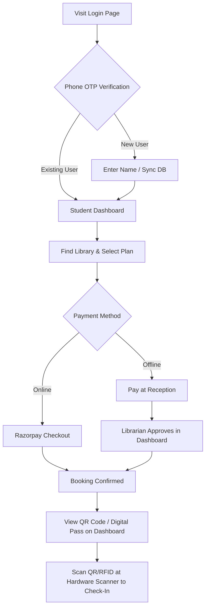
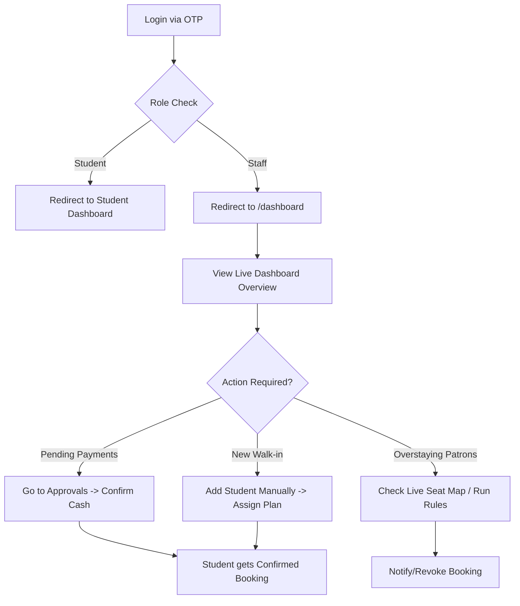

# Phase 2: Users, Roles, and Journeys

**Summary**: The system supports four distinct roles: Student, Librarian, Receptionist, and Admin. Students book and access seats, Librarians own and manage libraries, Receptionists manage day-to-day operations for a specific library, and Admins have global oversight.
**Last verified against commit**: `90c4b5a1700d3f5308086aa1f42f8f9dff5289ee`

## Users and Roles

The application strictly defines access via the `Role` enum in Prisma (`STUDENT`, `LIBRARIAN`, `RECEPTIONIST`, `ADMIN`).

| Role | Domain Term | Description | Access & Permissions | Evidence |
|------|-------------|-------------|----------------------|----------|
| **Student** | Patron | Library user who books seats and studies. | Views own bookings, can pause/resume plans, accesses QR for entry, views Winter Arc leaderboard. Routed to `/(student)/student/dashboard`. | `src/app/actions/auth-actions.ts`, `src/app/(student)/student/dashboard/page.tsx` |
| **Librarian** | Library Owner/Manager | Owns the library and manages its settings. | Full access to `/dashboard`. Scoped to libraries they own (`librarianId === userId`). Manages plans, seats, hardware, and financials. | `src/lib/dashboard-utils.ts`, `schema.prisma` |
| **Receptionist** | Staff / Desk Clerk | Assists with daily operations at the front desk. | Accesses `/dashboard`. Scoped only to their assigned library (`employerLibraryId`). Can process manual payments, check-ins, and add students. | `src/app/actions/student-actions.ts:497`, `src/app/api/checkout/reception/route.ts:72` |
| **Admin** | Superadmin | Global administrator for the FocusDesk platform. | Full access to `/dashboard` across *all* libraries. Bypasses `librarianId` filters. | `src/app/actions/student-actions.ts:498`, `src/app/dashboard/layout.tsx:24` |

---

## User Journeys

### 1. Student Onboarding and Booking Journey
This journey describes how a student joins and accesses the library.

*Note: A student's journey pauses if they select "Pay at Reception" until a staff member manually approves the transaction.*

### 2. Librarian / Receptionist Daily Operations Journey
This journey covers how staff manage the library space and patrons.

*Note: The hardware flow automatically populates the Live Seat Map and Entry Logs, meaning the librarian does not need to manually check students in unless they forgot their phone/card.*

### Incomplete or Dead-End Journeys
- **Checkout without scanner**: If a library lacks a scanner, manual checkout UI is implied but primarily relies on the receptionist manually updating logs or relying on the automated "absent" rule engine.
- **Admin global view**: While `ADMIN` role exists and bypasses filters, there isn't a dedicated "Superadmin" global view page (e.g., aggregate stats across all libraries) documented in the UI; admins simply see the librarian dashboard but for any library.
