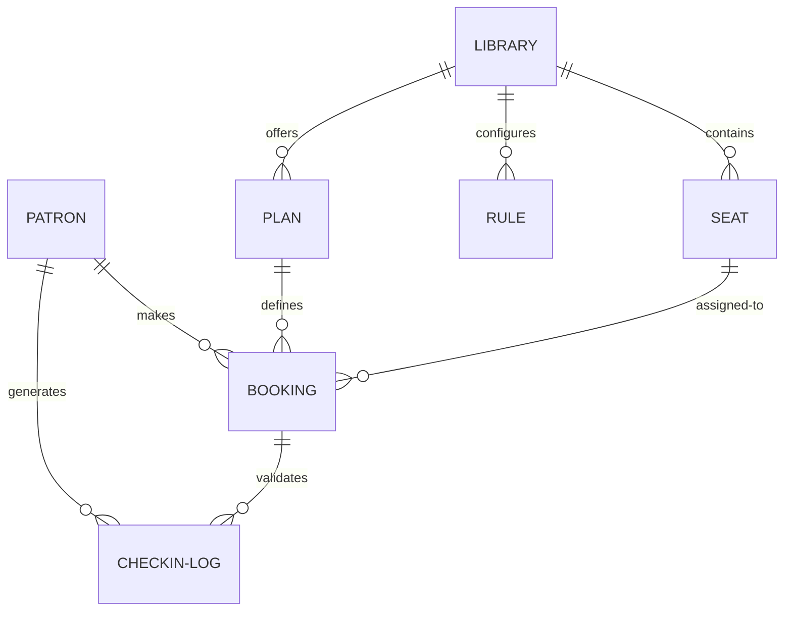

# Phase 5: Data and Privacy

**Summary**: A plain-language overview of what information the system collects, how it's connected, its lifecycle, and how patron privacy is handled.
**Last verified against commit**: `90c4b5a1700d3f5308086aa1f42f8f9dff5289ee`

## Core Data Entities (The "Things" We Store)

| Entity | What it represents | Key Fields |
|--------|--------------------|------------|
| **Patron (User)** | Anyone using or managing the system. | Phone number, Name, Role (Student/Librarian). |
| **Library** | A physical study space. | Name, Address, Location, Facilities, Manager details. |
| **Seat / Locker** | A physical asset inside the library. | Grid position (X/Y), Type (Normal/Premium), Locker price. |
| **Plan** | A subscription package (e.g., "1 Month 12 Hours"). | Duration in hours, Validity in days, Price. |
| **Booking** | A confirmed subscription for a patron. | Start/End dates, Status, Paused days, Amount Paid. |
| **Checkout (BookingIntent)** | A temporary cart while payment is processed. | Amount Expected, Expiry Time, Payment Link. |
| **Check-in Log** | A record of a patron entering or leaving. | Timestamp, Status (In/Out), Offline Sync flag. |
| **Rule** | An automated workflow set by the librarian. | Trigger (e.g., Overstay), Condition (> 2 hours), Action. |

## How Data Relates (ER Diagram)

## Data Lifecycle

1. **Creation**: Patron records created on first OTP login. Bookings begin as `BookingIntent`.
2. **Changes**: Bookings can be paused (extends end date) or cancelled.
3. **Archiving & Deletion**: Records are rarely deleted to maintain history. Expired bookings remain `COMPLETED`.

## Privacy & Security

### What personal data is stored?
- Full Name, Phone Number, Date of Birth, Gender, Address.
- **Aadhaar Data**: Cashfree Digilocker verification fetches Aadhaar data directly.
- **Location/Access Data**: Precise timestamps of when a patron enters and leaves the building.

### Who can see it?
- **Librarians/Receptionists**: Can see data of patrons currently booked at their specific library.
- **Admins**: Can see data across *all* libraries.
- **Payment Details**: Not stored; handled securely by Razorpay.

*(Note: Data privacy risks regarding Aadhaar/PII storage have been moved to [07-gaps-and-roadmap.md](07-gaps-and-roadmap.md) as a top-level risk).*
