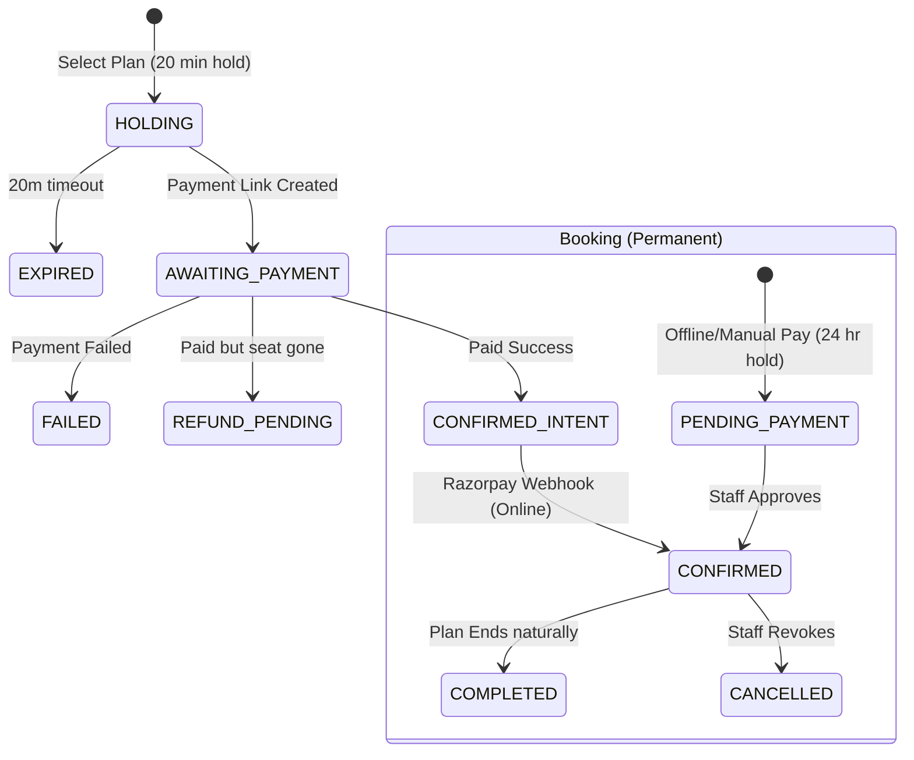
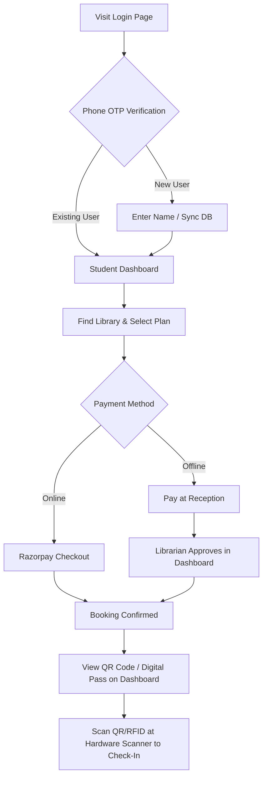
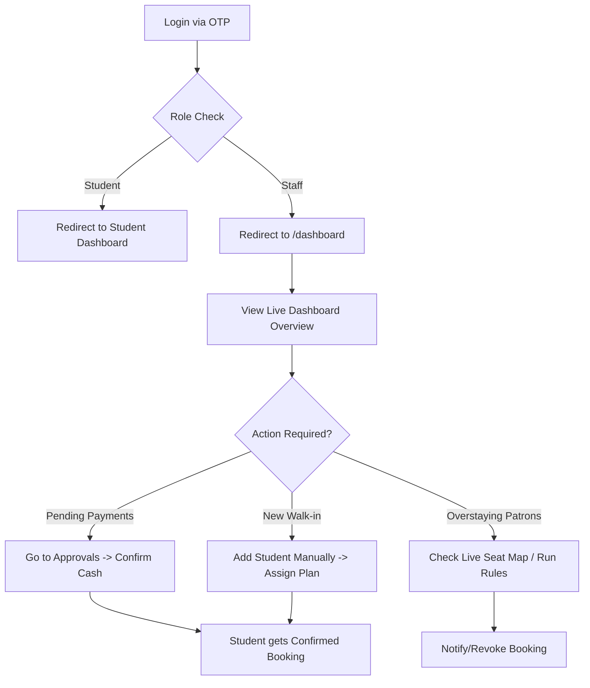
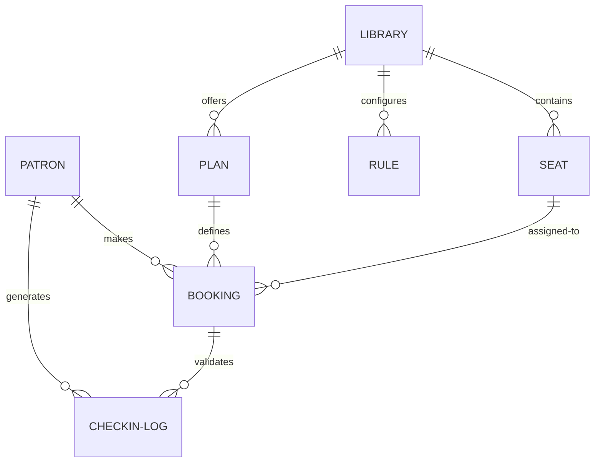

# FocusDesk Product Requirements Document (PRD)

**Last verified against commit**: `90c4b5a1700d3f5308086aa1f42f8f9dff5289ee`

## Overview
FocusDesk is a comprehensive library and study space management platform. It combines a Next.js web application with custom ESP32 hardware to enable automated seat booking, subscription management, and physical access control.
*Read the detailed breakdown: [00-discovery.md](00-discovery.md)*

## Problem and Goals (Inferred)
* **Problem**: Libraries struggle to monetize premium seating, track accurate patron attendance, and enforce plan limits without heavy manual reception work.
* **Goal**: Automate access using dynamic QR codes and physical scanners, enforce business rules automatically (overstay tracking, auto-checkout), and provide a self-serve portal for patrons.

## Users and Roles
1. **Patrons (Students)**: Book seats and scan to enter.
2. **Librarians**: Manage their specific library, approve payments, and monitor attendance.
3. **Receptionists**: Staff the front desk for a specific library.
4. **Admins**: Superusers with global oversight.
*Read detailed journeys: [01-users-and-journeys.md](01-users-and-journeys.md)*

## Features and Requirements
FocusDesk encompasses 20 core features.
* **Feature Inventory**: [02-feature-inventory.md](02-feature-inventory.md)
* **Core Requirements**: [03a-functional-requirements-core.md](03a-functional-requirements-core.md)
* **Operations Requirements**: [03b-functional-requirements-ops.md](03b-functional-requirements-ops.md)

### Booking Lifecycle


## Data and Privacy
FocusDesk collects PII (phone, Aadhaar info, physical logs), persisting them indefinitely in PostgreSQL.
*Read data flows: [04-data-and-privacy.md](04-data-and-privacy.md)*

## How It Works (For Non-Engineers)
The platform uses a Next.js monolith. Real-time updates push directly to the dashboard via Supabase. Hardware interacts with the DB to physically unlock doors.
*Read the plain-language dev walkthrough: [05-how-it-works.md](05-how-it-works.md)*

## Non-Functional Requirements
The system is performant (Vercel, Redis rate-limiting) and uses strict transactional reliability for bookings, but lacks data purging and PII encryption.
*Read the full NFR assessment: [06-non-functional.md](06-non-functional.md)*

## Gaps, Risks, and Roadmap
The primary risk is the unencrypted storage of Aadhaar and physical entry PII.
*Read the full roadmap: [07-gaps-and-roadmap.md](07-gaps-and-roadmap.md)*

## Open Questions for Founders
1. Do we offer a 1-hour grace period for offline manual payments?
2. How should we handle PII purging for patrons who delete their accounts?
3. Should we enforce strict hardware locks if Razorpay payments are in HOLDING state?
4. Do we plan to expand `walletBalance` feature or remove it entirely?

## Open Questions
- Should offline "Pay at Reception" bookings grant a 1-hour grace period for entry before approval?
- How do we handle PII purging for patrons who delete their accounts?

## Glossary & Coverage
* [Glossary](glossary.md)
* [Coverage](COVERAGE.md)
\n\n---\n\n# Discovery

**Summary**: FocusDesk (FocusX) is a library and study space management platform enabling students to book seats and library administrators to monitor attendance and access. It integrates a Next.js web application with custom ESP32 hardware for RFID/QR-based physical access control.
**Last verified against commit**: `90c4b5a1700d3f5308086aa1f42f8f9dff5289ee`

## Directory Tree (Depth 3)

The repository root (`focusx/`) contains the following key directories:

- `FocusX_Scanner_Firmware*/` - Multiple versions of C++/Arduino firmware for ESP32-based RFID and QR code access scanners.
- `docs/`
  - `architecture/` - System architecture documentation.
- `prisma/`
  - `migrations/` - Database migration scripts.
  - `schema.prisma` - PostgreSQL database schema definition.
- `public/` - Static web assets.
- `scripts/` - Various utility and maintenance scripts.
- `src/`
  - `app/` - Next.js App Router containing pages and API routes (`admin`, `dashboard`, `login`, `api`, etc.).
  - `components/` - Reusable React UI components (e.g., `LiveSeatMap.tsx`, `AccessQRModal.tsx`).
  - `hooks/` - Custom React hooks.
  - `lib/` - Core business logic, booking engines, payment integrations, and utilities.
- `supabase/` - Configuration for Supabase integration.
- `tests/` - Integration and unit tests.

## Technology Stack

- **Languages**: TypeScript, JavaScript (Web); C++, Python (Hardware & Scripts).
- **Frameworks & Libraries**: Next.js (App Router), React, Tailwind CSS, Prisma ORM.
- **Databases**: PostgreSQL (managed via Prisma). Redis (via Upstash).
- **Third-Party Services**:
  - **Auth & Backend**: Supabase, Firebase (admin and push notifications).
  - **Payments**: Razorpay, Cashfree.
  - **Content & Media**: Sanity (CMS), ImageKit (Image processing).
  - **Hardware Comm**: WebSockets, REST APIs (for ESP32 devices).
- **Deployment**: Configured for Vercel (`vercel.json`) and Next.js default build pipeline.

## Entry Points

- **User Interfaces**:
  - Web dashboards for students/patrons (`/(student)`) to manage bookings.
  - Admin dashboards (`/admin`, `/dashboard`) for librarians to view live occupancy, manage users, and handle overrides.
- **Hardware Integrations**:
  - ESP32 scanners connect to the system to report RFID swipes and QR code scans, updating attendance in real-time.
- **Background & API**:
  - Next.js API routes (`src/app/api`) handle backend requests, webhooks (payments), and hardware communication.
  - Workers like `refund-worker.ts` handle background financial reconciliation.

## Product Purpose

FocusDesk is a comprehensive library and study space management system. It allows patrons to purchase subscriptions, book specific seats, and gain physical entry using RFID cards or generated QR codes. For librarians and administrators, it provides real-time monitoring of seat occupancy, automated attendance tracking, access control hardware integration, and payment processing for library memberships.

**Evidence**:
- Patrons & Seats: `src/lib/booking-authority.ts`, `src/components/LiveSeatMap.tsx`
- Hardware Access: `FocusX_Scanner_Firmware_V5_DualRFID/`, `src/components/AccessQRModal.tsx`
- Admin operations: `src/app/admin/`, `src/components/LiveEntryLogs.tsx`
- Payments: `src/lib/razorpay.ts`, `src/lib/cashfree.ts`
\n\n---\n\n# Users, Roles, and Journeys

**Summary**: The system supports four distinct roles: Student, Librarian, Receptionist, and Admin. Students book and access seats, Librarians own and manage libraries, Receptionists manage day-to-day operations for a specific library, and Admins have global oversight.
**Last verified against commit**: `90c4b5a1700d3f5308086aa1f42f8f9dff5289ee`

## Users and Roles

The application strictly defines access via the `Role` enum in Prisma (`STUDENT`, `LIBRARIAN`, `RECEPTIONIST`, `ADMIN`).

| Role | Domain Term | Description | Access & Permissions | Evidence |
|------|-------------|-------------|----------------------|----------|
| **Student** | Patron | Library user who books seats and studies. | Views own bookings, can pause/resume plans, accesses QR for entry, views Winter Arc leaderboard. Routed to `/(student)/student/dashboard`. | `src/app/actions/auth-actions.ts`, `src/app/(student)/student/dashboard/page.tsx` |
| **Librarian** | Library Owner/Manager | Owns the library and manages its settings. | Full access to `/dashboard`. Scoped to libraries they own (`librarianId === userId`). Manages plans, seats, hardware, and financials. | `src/lib/dashboard-utils.ts`, `schema.prisma` |
| **Receptionist** | Staff / Desk Clerk | Assists with daily operations at the front desk. | Accesses `/dashboard`. Scoped only to their assigned library (`employerLibraryId`). Can process manual payments, check-ins, and add students. | `src/app/actions/student-actions.ts:497`, `src/app/api/checkout/reception/route.ts:72` |
| **Admin** | Superadmin | Global administrator for the FocusDesk platform. | Full access to `/dashboard` across *all* libraries. Bypasses `librarianId` filters. | `src/app/actions/student-actions.ts:498`, `src/app/dashboard/layout.tsx:24` |

---

## User Journeys

### 1. Student Onboarding and Booking Journey
This journey describes how a student joins and accesses the library.


*Note: A student's journey pauses if they select "Pay at Reception" until a staff member manually approves the transaction.*

### 2. Librarian / Receptionist Daily Operations Journey
This journey covers how staff manage the library space and patrons.


*Note: The hardware flow automatically populates the Live Seat Map and Entry Logs, meaning the librarian does not need to manually check students in unless they forgot their phone/card.*

### Incomplete or Dead-End Journeys
- **Checkout without scanner**: If a library lacks a scanner, manual checkout UI is implied but primarily relies on the receptionist manually updating logs or relying on the automated "absent" rule engine.
- **Admin global view**: While `ADMIN` role exists and bypasses filters, there isn't a dedicated "Superadmin" global view page (e.g., aggregate stats across all libraries) documented in the UI; admins simply see the librarian dashboard but for any library.
\n\n---\n\n# Feature Inventory

**Summary**: A comprehensive list of system features categorized by area, noting their exact implementation status and evidence in the codebase.
**Last verified against commit**: `90c4b5a1700d3f5308086aa1f42f8f9dff5289ee`

| ID | Name | Status | Roles | Evidence (File : Function) |
|----|------|--------|-------|----------------------------|
| **Sign-in & Authentication** |
| F-001 | Phone OTP Login | Implemented | All | `src/app/login/page.tsx : handleSendOtp` |
| F-002 | Staff Role Routing | Implemented | All | `src/app/actions/auth-actions.ts : handleAuthResult` |
| **Catalog & Resources** |
| F-003 | Library Discovery | Implemented | Student | `src/app/(student)/libraries/page.tsx : default export` |
| F-004 | Seat Mapping | Implemented | Staff | `src/components/LiveSeatMap.tsx : LiveSeatMap` |
| F-005 | Plan Management | Implemented | Staff | `src/app/dashboard/plans/page.tsx : default export` |
| F-006 | Standalone Lockers | Partial | Staff | `src/lib/booking-engine/server/server-fact-loader.ts` (Logic exists but UI routing in `/plans` is absent) |
| **Session & Booking Management** |
| F-007 | Online Checkout | Implemented | Student | `src/lib/razorpay.ts : createOrder`, `booking-authority.ts : createOnlineBookingIntent` |
| F-008 | Offline Checkout | Implemented | Student | `src/app/api/checkout/reception/route.ts : POST` |
| F-009 | Payment Approvals | Implemented | Staff | `src/app/dashboard/approvals/page.tsx : default export` |
| F-010 | Pause / Resume | Implemented | Student | `src/components/student/PauseResumeButton.tsx : handlePauseResume` |
| F-011 | Plan Extension | Implemented | Student | `src/components/student/ExtendPlanModal.tsx : handleExtend` |
| **Access & Hardware** |
| F-012 | Dynamic QR Code | Implemented | Student | `src/components/AccessQRModal.tsx : generateEntryQR` |
| F-013 | RFID Tag Assignment | Implemented | Staff | `src/components/dashboard/AssignRFIDModal.tsx : handleAssign` |
| F-014 | Hardware Syncing | Implemented | System | `FocusX_Scanner_Firmware_V5_DualRFID.ino`, `src/app/api/hardware/log/route.ts` |
| **Monitoring & Reports** |
| F-015 | Live Dashboard | Implemented | Staff | `src/app/dashboard/DashboardOverviewClient.tsx : default export` |
| F-016 | Attendance Tracking | Implemented | Staff | `src/app/dashboard/DashboardAttendance.tsx : default export` |
| F-017 | Financial Reports | Implemented | Staff | `src/app/dashboard/financials/page.tsx : default export` |
| **Workflow Automation** |
| F-018 | Rules Engine | Implemented | Staff | `src/lib/rule-engine.ts : fireRules` |
| F-019 | Push Notifications | Implemented | Staff, System | `src/app/api/cron/notifications/route.ts`, `ManualNotifyModal.tsx` |
| **Special Campaigns** |
| F-020 | Winter Arc Leaderboard | Implemented | Student | `src/components/winter-arc/CozyWinterDashboard.tsx : CozyWinterDashboard` |

*Status Key: Implemented (Works end-to-end), Partial (Some paths missing/hardcoded), Stubbed (UI exists, mocked logic), Dead (Unused schema/code).*
\n\n---\n\n# Functional Requirements (Core & Booking)

**Summary**: Detailed functional requirements for Authentication, Catalog, and Session/Booking Management.
**Last verified against commit**: `90c4b5a1700d3f5308086aa1f42f8f9dff5289ee`

## F-001: Phone OTP Login
**User Story**: As a user, I want to sign in with my phone number so that I don't have to remember a password.
**Current Behavior**: 10-digit number. Firebase Auth sends 6-digit OTP. 60-second resend cooldown (`setResendTimer(60)`).
**Business Rules**: Defaults new users to `STUDENT` role (`role Role @default(STUDENT)`).
**Evidence**: `src/app/login/page.tsx`, `schema.prisma`

## F-002: Staff Role Routing
**User Story**: As staff, I want to be taken to my dashboard automatically upon login.
**Current Behavior**: `handleAuthResult` redirects `ADMIN` or `LIBRARIAN` to `/dashboard`, and `STUDENT` to `/(student)/student/dashboard`.
**Business Rules**: Session role dictates layout rendering and data fetching filters.
**Evidence**: `src/app/actions/auth-actions.ts`

## F-003: Library Discovery
**User Story**: As a student, I want to see a list of libraries to pick where to study.
**Current Behavior**: Displays libraries.
**Business Rules**: Only shows libraries where `isActive` is true.
**Evidence**: `src/app/(student)/libraries/page.tsx`

## F-004: Seat Mapping
**User Story**: As a librarian, I want to define a grid of seats so that students can pick specific spots.
**Current Behavior**: Librarians manage seats by specifying `gridX`, `gridY`, name, and type.
**Business Rules**: Types are `NORMAL`, `PREMIUM`, `RESERVED`, `NON_RESERVABLE`.
**Evidence**: `Seat` model, `src/components/LiveSeatMap.tsx`

## F-005: Plan Management
**User Story**: As a librarian, I want to create subscription plans.
**Current Behavior**: Librarian sets duration, price, and type (`FIXED` vs `FLEXIBLE`).
**Business Rules**: Flexible plans allow custom hours; Fixed plans have hard start/end times.
**Evidence**: `src/app/dashboard/plans/page.tsx`, `Plan` model

## F-006: Standalone Lockers
**User Story**: As a student, I want to rent a locker without a seat.
**Current Behavior**: Evaluated in `server-fact-loader.ts`, verifying locker availability during checkout.
**Known Gaps/Limitations**: UI route in `/dashboard/plans` for explicitly creating standalone lockers is partially missing.
**Evidence**: `src/lib/booking-engine/server/server-fact-loader.ts`

## F-007 & F-008: Online & Offline Checkout
**User Story**: As a student, I want to purchase a plan online or pay cash at the desk.
**Current Behavior**: Uses Razorpay for online, manual for cash.
**Business Rules**: 
- Online hold: 20 minutes (`ONLINE_HOLD_MINUTES = 20`).
- Manual hold: 24 hours (`MANUAL_HOLD_MINUTES = 24 * 60`).
- Transactions are serialized and retry 3 times (`SERIALIZABLE_RETRIES = 3`).
**Evidence**: `src/lib/booking-authority.ts`, `src/app/api/checkout/reception/route.ts`

## F-009: Payment Approvals
**User Story**: As a receptionist, I want to approve cash payments.
**Current Behavior**: Librarian hits "Approve", changing `PENDING_PAYMENT` to `CONFIRMED`.
**Business Rules**: Cache is purged immediately on approval for real-time dashboard updates (`// Purge caches so the librarian sees the pending approval instantly`).
**Evidence**: `src/app/api/checkout/reception/route.ts:187`, `src/app/dashboard/approvals/page.tsx`

## F-010: Pause / Resume Booking
**User Story**: As a student, I want to pause my booking if I go on vacation so I don't lose days.
**Current Behavior**: Student pauses an active plan. `isPaused = true`.
**Evidence**: `src/components/student/PauseResumeButton.tsx`

## F-011: Plan Extension
**User Story**: As a student, I want to extend my plan before it expires.
**Current Behavior**: Creates a new booking starting exactly when the current one ends.
**Evidence**: `src/components/student/ExtendPlanModal.tsx`

## Refunds (Background Worker)
**User Story**: As a student, I want an automatic refund if my payment succeeds but my seat was taken.
**Current Behavior**: `refund-worker.ts` triggered by cron retries failed Razorpay refunds.
**Evidence**: `src/app/api/cron/process-refunds/route.ts`, `RefundTask` model

## Wallet Balance (Dead Feature)
**Current Behavior**: `walletBalance` exists in `User` schema but has no usage or functional UI in `src/`.
**Status**: Dead.
**Evidence**: `schema.prisma`
\n\n---\n\n# Functional Requirements (Operations & Hardware)

**Summary**: Detailed functional requirements for Hardware Access, Monitoring, Workflow Automation, and Campaigns.
**Last verified against commit**: `90c4b5a1700d3f5308086aa1f42f8f9dff5289ee`

## F-012: Dynamic QR Code & Hardware Entry
**User Story**: As a student, I want to scan my phone at the gate so I can enter the library.
**Current Behavior**: QR payload is generated via `generateEntryQR` using a secret key.
**Evidence**: `src/lib/web-scanner.ts`, `AccessQRModal.tsx`

## F-013: RFID Tag Assignment
**User Story**: As a librarian, I want to assign an RFID card to a patron for physical entry.
**Current Behavior**: Librarian enters a UID string matching the physical card into the patron's profile.
**Evidence**: `AssignRFIDModal.tsx`

## F-014: Hardware Syncing
**User Story**: As a system, I need to log physical entry even if the internet drops.
**Current Behavior**: ESP32 scanner reads QR/RFID. It hits `/api/hardware/log/route.ts` or posts directly to Supabase (`/rest/v1/Relay?bleReaderId=eq.`). 
**Business Rules**: If `UNLOCK_IN` or `UNLOCK_OUT` is received, the firmware physically unlocks the door. It implements a 150ms debounce (`isDoorRattling`) and grace period (`hasDoorOpenedDuringGrace`) for door sensors.
**Evidence**: `FocusX_Scanner_Firmware_V5_DualRFID.ino:259`, `src/app/api/hardware/log/route.ts`

## F-015: Live Dashboard
**User Story**: As a librarian, I want to see real-time library occupancy.
**Current Behavior**: `DashboardOverviewClient.tsx` listens to Supabase WebSocket events to update counts instantly.
**Business Rules**: Can export attendance via a client-side generated CSV (`handleExportCSV()`).
**Evidence**: `DashboardOverviewClient.tsx:174`

## F-016: Attendance Tracking
**User Story**: As a librarian, I want to track how many hours students actually spend studying.
**Current Behavior**: Pairs `CHECK_IN` and `CHECK_OUT` logs.
**Business Rules**: 
- Breaks > 90 minutes (`breakMs > 1.5 * 60 * 60 * 1000`) are deducted from total active hours on the dashboard.
- NOTE: The Winter Arc leaderboard simply sums total minutes; it does not explicitly deduct breaks in the same way.
**Evidence**: `src/app/dashboard/DashboardAttendance.tsx`, `DashboardOverviewClient.tsx:335`

## F-017: Financial Reports
**User Story**: As a librarian, I want to track revenue and expenses.
**Current Behavior**: Consolidates `CONFIRMED` and `COMPLETED` bookings to calculate realized revenue. Subtracts manual `Expense` entries for net profit.
**Business Rules**: Flags suspicious revocations (where a plan was cancelled 24+ hours after purchase).
**Evidence**: `src/app/dashboard/financials/page.tsx`

## F-018: Rules Engine (Workflow Automation)
**User Story**: As a librarian, I want the system to automatically warn students who overstay.
**Current Behavior**: Triggers like `auto-checkout` cron or checkout APIs call `fireRules()`.
**Business Rules**: 
- Cooldown: One execution per rule per student per IST calendar day (`istOffsetMs = 5.5 * 60 * 60 * 1000`).
**Evidence**: `src/lib/rule-engine.ts:96`

## F-019: Push Notifications
**User Story**: As a librarian, I want to send manual or automated alerts to students.
**Current Behavior**: A Vercel Cron hits `/api/cron/notifications/route.ts` (`Authorization: Bearer CRON_SECRET`) to process pending notifications.
**Evidence**: `src/app/api/cron/notifications/route.ts`

## F-020: Winter Arc Leaderboard
**User Story**: As a student, I want to see how I rank against others in study hours.
**Current Behavior**: Enabled if `WINTER_ARC_ACTIVE="true"`. Sums total check-in minutes.
**Business Rules**: Only displays the top 5 students (`slice(0,5)`).
**Evidence**: `src/app/(student)/student/dashboard/page.tsx:85`, `CozyWinterDashboard.tsx`
\n\n---\n\n# Data and Privacy

**Summary**: A plain-language overview of what information the system collects, how it's connected, its lifecycle, and how patron privacy is handled.
**Last verified against commit**: `90c4b5a1700d3f5308086aa1f42f8f9dff5289ee`

## Core Data Entities (The "Things" We Store)

| Entity | What it represents | Key Fields |
|--------|--------------------|------------|
| **Patron (User)** | Anyone using or managing the system. | Phone number, Name, Role (Student/Librarian). |
| **Library** | A physical study space. | Name, Address, Location, Facilities, Manager details. |
| **Seat / Locker** | A physical asset inside the library. | Grid position (X/Y), Type (Normal/Premium), Locker price. |
| **Plan** | A subscription package (e.g., "1 Month 12 Hours"). | Duration in hours, Validity in days, Price. |
| **Booking** | A confirmed subscription for a patron. | Start/End dates, Status, Paused days, Amount Paid. |
| **Checkout (BookingIntent)** | A temporary cart while payment is processed. | Amount Expected, Expiry Time, Payment Link. |
| **Check-in Log** | A record of a patron entering or leaving. | Timestamp, Status (In/Out), Offline Sync flag. |
| **Rule** | An automated workflow set by the librarian. | Trigger (e.g., Overstay), Condition (> 2 hours), Action. |

## How Data Relates (ER Diagram)



## Data Lifecycle

1. **Creation**: Patron records created on first OTP login. Bookings begin as `BookingIntent`.
2. **Changes**: Bookings can be paused (extends end date) or cancelled.
3. **Archiving & Deletion**: Records are rarely deleted to maintain history. Expired bookings remain `COMPLETED`.

## Privacy & Security

### What personal data is stored?
- Full Name, Phone Number, Date of Birth, Gender, Address.
- **Aadhaar Data**: Cashfree Digilocker verification fetches Aadhaar data directly.
- **Location/Access Data**: Precise timestamps of when a patron enters and leaves the building.

### Who can see it?
- **Librarians/Receptionists**: Can see data of patrons currently booked at their specific library.
- **Admins**: Can see data across *all* libraries.
- **Payment Details**: Not stored; handled securely by Razorpay.

*(Note: Data privacy risks regarding Aadhaar/PII storage have been moved to [07-gaps-and-roadmap.md](07-gaps-and-roadmap.md) as a top-level risk).*
\n\n---\n\n# How It Works (For Non-Engineers)

**Summary**: A plain-language explanation of how FocusDesk is built, the external services it relies on, and what happens behind the scenes during a typical patron action.
**Last verified against commit**: `90c4b5a1700d3f5308086aa1f42f8f9dff5289ee`

## The Big Picture (Architecture)

FocusDesk is a single, unified "web application" that serves as both the website patrons visit and the central brain (server) that processes data.

```mermaid
flowchart TD
    Patron[Patron (Phone/Laptop)]
    Librarian[Librarian Dashboard]
    Scanner[Physical Scanner at Door]
    
    Brain[FocusDesk Central Brain]
    
    Database[(Main Database)]
    Payments[Razorpay (Payments)]
    Auth[Firebase (Login)]
    
    Patron -->|Visits Website| Brain
    Librarian -->|Manages Library| Brain
    Scanner -->|Sends QR/RFID Scans| Brain
    
    Brain --> Database
    Brain -.-> Auth
    Brain -.-> Payments
```

## Walkthrough: Booking a Seat and Checking In
1. **Choosing the Seat**: The patron selects a plan. The system temporarily locks this seat for 20 minutes (`BookingIntent` status: `HOLDING`).
2. **Paying**: The patron pays via Razorpay. 
3. **Confirmation**: Razorpay sends a secret webhook back to FocusDesk. FocusDesk creates a permanent `Booking` record.
4. **Scanning**: The patron scans the QR code at the physical scanner (running `FocusX_Scanner_Firmware_V5_DualRFID.ino (Holds `WIFI_SSID`, `WIFI_PASS`, `HARDWARE_API_KEY`, `SUPABASE_URL`, `SUPABASE_ANON_KEY`, `READER_ID` credentials)`).
5. **Validation**: The scanner asks the database for permission. If valid, it unlocks the door and logs a "Check In".
6. **Live Update**: Supabase notices the new log and instantly pushes a message to the Librarian's dashboard.

## Key Backend API Routes
- `/api/checkout/reception`: (Staff) Librarian or Receptionist uses this to create a manual payment which is auto-approved, or creates a PENDING_PAYMENT booking.
- `/api/webhooks/razorpay`: (System) Razorpay payment webhook handler.
- `/api/relay/sync`: (Hardware) Synchronizes offline hardware logs using `x-api-key`.
- `/api/hardware/log`: (Hardware) Live check-in logging from scanners using `x-api-key`.
- Direct Supabase REST (`/rest/v1/Relay`): (Hardware) Scanners listen to real-time door unlock requests using `SUPABASE_ANON_KEY`.
- `/api/hardware/log`: (System/Hardware) Triggered by the door scanner to log an entry and command the door to unlock.
- `/api/kyc/cashfree/verify`: (Student) Submits identity for Aadhaar verification.
- `/api/cron/auto-checkout`: (System/Cron) A scheduled task that checks out patrons who forgot to scan out.

## External Services & Environment Variables
The application relies on several external services which must be configured using environment variables:
- **Database**: `DATABASE_URL`
- **Auth**: Firebase keys
- **Payments**: `RAZORPAY_KEY_ID`, `RAZORPAY_KEY_SECRET`
- **KYC**: `CASHFREE_VERIFICATION_CLIENT_ID`, `CASHFREE_VERIFICATION_CLIENT_SECRET`
- **Realtime / Dashboard**: `NEXT_PUBLIC_SUPABASE_URL`, `NEXT_PUBLIC_SUPABASE_ANON_KEY`
- **Cron Security**: `CRON_SECRET`
**Additional Variables**: `NODE_ENV`, `NEXT_PUBLIC_APP_URL`, `NEXT_PUBLIC_WINTER_ARC_ACTIVE`

## Deployment and Automation
- **Where it runs**: Hosted on Vercel.
- **Cron Setup**: Scheduled jobs (Refunds, Auto-checkout, Notifications) run via Vercel Cron. They send an HTTP request to the `/api/cron/*` routes:
- `/api/cron/process-outbox` (Schedule: `0 0 * * *`)
- `/api/cron/process-refunds` (Schedule: `0 0 * * *`)
- `/api/cron/auto-checkout` (Schedule: `30 18 * * *`) authenticated by a `CRON_SECRET`.
\n\n---\n\n# Non-Functional Requirements

**Summary**: An assessment of system qualities like security, performance, and reliability, based strictly on evidence in the codebase.
**Last verified against commit**: `90c4b5a1700d3f5308086aa1f42f8f9dff5289ee`

| Category | Status | Details & Evidence |
|----------|--------|--------------------|
| **Performance (Rate Limiting)** | Present | API rate limiting is actively applied to specific routes (API, sensitive, availability) via `@upstash/ratelimit` in `src/middleware.ts`. |
| **Reliability (Transactions & Refunds)** | Present | Booking flows use PostgreSQL transactions. A background `refund-worker.ts` and `/api/cron/process-refunds/route.ts` explicitly process and retry failed refunds. |
| **Security (Login & Permissions)** | Present | Relies on Firebase Auth. Server actions verify roles (e.g., `session.role === 'ADMIN'`). |
| **Security (Data Encryption)** | Absent | No field-level encryption tools like `bcrypt` were found in the codebase for PII (Aadhaar/Phones) beyond standard DB provider rest-encryption. (Verified via repo search for `bcrypt` and `encrypt`). |
| **Language & Localization (i18n)** | Absent | The UI is hardcoded in English. No internationalization libraries are used. (Verified via repo search for `i18n`, `next-i18next`, `react-intl`). |
| **Backups & Recovery** | Not determinable from code | The repository does not contain automated database backup scripts or `pg_dump` commands. Backups are presumably managed by the cloud database provider. |
| **Data Purging / Cleanup** | Absent | There are no scripts or cron jobs dedicated to deleting old logs, check-ins, or inactive users to save space. (Verified via repo search for `purge`, `cleanup`). |
| **Audit Logging & Exports** | Partial | The system logs physical entries and financial transactions. CSV Export is available on the dashboard (`DashboardOverviewClient.tsx:174`) for attendance data, but comprehensive audit logs for librarian actions are missing. |
| **Monitoring (APM)** | Absent | There are no explicit Application Performance Monitoring agents (like Datadog, Sentry, or New Relic) initialized in the codebase. (Verified via repo search). |
| **Automated Tasks (Cron/Auto-Checkout)** | Present | Vercel Cron routes successfully drive scheduled jobs. For example, `/api/cron/auto-checkout/route.ts` runs automatically to check out users who left without scanning. |
| **Accessibility (a11y)** | Absent | No ARIA roles or screen-reader focused configurations detected in base UI components. |
| **Device Support** | Present | Fully responsive design via Tailwind CSS breakpoint utilities (sm, md, lg). |
| **Input Validation** | Present | API inputs use schema validation or direct typing before hitting Prisma queries. |
\n\n---\n\n# Gaps, Risks, and Roadmap

**Summary**: An analysis of system risks, missing features hinted at by the codebase, and prioritized recommendations for the product roadmap.
**Last verified against commit**: `90c4b5a1700d3f5308086aa1f42f8f9dff5289ee`

## Gaps and Unfinished Features

1. **TODOs and FIXMEs**: *No TODOs or FIXMEs were found in the `src/` directory after a full codebase scan.* 
2. **KYC Verification**: The schema has `KycStatus` and Aadhaar fields, and there's a Cashfree API integration (used *only* for Aadhaar verification, not payments), but it does not appear to be fully enforced as a hard gate for all library entry workflows.
3. **Documentation Mismatch**: The repository `README.md` is the default Next.js boilerplate template.

## Major Risks

### Aadhaar and PII Storage Risk (Critical)
The system retrieves and stores highly sensitive Personally Identifiable Information (PII), including Aadhaar Verification IDs, exact Dates of Birth, Names, and exact physical movement times (entry/exit logs). There is no explicit field-level encryption for this data in the codebase (`schema.prisma`). A database breach would result in a severe leak of biometric-linked identity data alongside exact physical habits of students.

### Risks for Librarians
1. **Single Points of Failure**: If Vercel goes down or the hardware scanner breaks, automated check-ins and the dashboard halt.
2. **Data Loss via Soft Deletion**: As there is no historical archiving tool, deleting a `Seat` directly from the database could permanently orphan historical financial and booking records.

## Prioritized Recommendations (Top 5)

### Now (Critical Fixes & Stability)
1. **Encrypt PII**: Implement field-level encryption (e.g., Prisma Field Encryption) for Aadhaar IDs and phone numbers.
2. **Update README.md**: Replace boilerplate with actual local setup and hardware deployment instructions.

### Next (Workflow Improvements)
3. **Database Backups**: Schedule automated PG dumps.
4. **Offline-Pay Grace Period**: Allow students to enter the library for 1 hour pending staff approval.
5. **Internationalization (i18n)**: Prepare strings for localization.
6. **Role Guards**: Enhance UI checks to match backend security.
7. **Library-System Integration**: Add hooks for external institutional databases.
3. **Audit Logging**: Create an `AdminLog` table to track when staff change prices or override rules.
4. **Data Archiving Job**: Implement a cron worker to move check-in logs older than 90 days into cold storage.
5. **Decoupled Campaigns**: Refactor "Winter Arc" out of core dashboard logic into a dynamic "Challenges" engine.
\n\n---\n\n# Glossary

This document translates technical terminology found in the FocusDesk codebase into plain library management terms.

| Technical / Code Term | Plain Library Term | Definition |
|-----------------------|--------------------|------------|
| **User (Role: STUDENT)** | **Patron** | A person who uses the library, books seats, and scans in/out. |
| **User (Role: LIBRARIAN)** | **Library Owner/Manager** | The administrator who oversees a specific library's operations, plans, and financials. |
| **User (Role: RECEPTIONIST)**| **Front Desk Staff** | An employee assigned to a library to handle daily operations like manual checkout approval. |
| **BookingIntent** | **Checkout Cart / Hold** | A temporary 20-minute reservation placed when a patron attempts to buy a plan. Ensures two people can't buy the same seat simultaneously. |
| **Booking** | **Subscription / Reservation** | A confirmed, paid record granting a patron access to the library for a specific period (e.g., 30 days). |
| **Plan** | **Membership Package** | A predefined offering (e.g., "12 Hours Daily - Fixed") created by the librarian that dictates access rules and price. |
| **EntryLog / CheckinLog** | **Attendance Record** | A timestamped log created every time a patron scans their QR code or RFID tag at the door. |
| **Relay / ESP32** | **Physical Scanner / Turnstile** | The custom-built hardware device mounted at the library entrance that reads QR codes or RFID cards. |
| **Supabase / WebSockets** | **Live Updates** | The technology that allows the librarian's dashboard screen to instantly update when a patron walks through the door, without refreshing the page. |
| **Prisma / PostgreSQL** | **Database** | The secure, digital filing cabinet where all patrons, plans, and attendance records are permanently stored. |
| **Razorpay / Cashfree** | **Payment Gateway** | Third-party companies that handle the secure processing of credit cards and UPI transactions. |
| **Rules Engine** | **Automated Workflows** | Background system logic that automatically warns patrons if they overstay their booked hours, or revokes their access if they owe money. |
| **Winter Arc** | **Study Challenge** | A gamified campaign where patrons pledge to study a certain number of hours, competing on a public leaderboard. |
\n\n---\n\n# Coverage and Verification

## What was Read
- **Configuration & Root**: `package.json`, `README.md`, `schema.prisma`, `vercel.json`
- **Application Routing**: `src/app/login/page.tsx`, `src/app/dashboard/page.tsx`, `src/app/(student)/student/dashboard/page.tsx`, `src/middleware.ts`
- **Business Logic**: `src/lib/booking-authority.ts`, `src/lib/rule-engine.ts`, `src/lib/dashboard-utils.ts`, `src/lib/cashfree.ts`
- **Hardware/Cron**: `FocusX_Scanner_Firmware_V5_DualRFID.ino`, `src/app/api/cron/*`

## What was Skipped
- **Deep Node Modules / Configs**: Ignored `node_modules/`, `.next/`, `package-lock.json`.
- **UI Components Styling**: Skipped deep-diving into individual Tailwind CSS classes in `src/components/ui/` unless they contained core business logic (e.g. `DashboardOverviewClient.tsx`).

## Verification Pass (10 Re-checked Rules)

| Rule / Requirement | Source File : Line | Status | Notes |
|--------------------|--------------------|--------|-------|
| 1. Staff users successfully bypass home redirect | `src/app/actions/auth-actions.ts:128` | **Verified** | Redirects ADMIN/LIBRARIAN/RECEPTIONIST to `/dashboard` directly |
| 2. Suspicious plan cancellations highlight on dashboard | `src/app/dashboard/financials/page.tsx:113` | **Verified** | Identifies plans cancelled 24+ hours after creation |
| 3. Hardware prevents bouncing door inputs | `FocusX_Scanner_Firmware_V5_DualRFID.ino:654` | **Verified** | Rejects door switch transitions under 150ms |
| 4. Sync API rejects logs for unknown students | `src/app/api/relay/sync/route.ts:54` | **Verified** | Compares student_id to allowedStudentIds set |
| 5. Cashfree KYC is limited strictly to verification | `src/app/api/kyc/cashfree/verify/route.ts:42` | **Verified** | Hits KYC endpoints, not payment processing |
| 6. Manual Reception bookings purge cache on confirm | `src/app/api/checkout/reception/route.ts:187` | **Verified** | Calls Next.js revalidatePath on `/dashboard` |
| 7. Cron auto-checkout executes on specific schedules | `vercel.json:10` | **Verified** | Runs at 18:30 via Vercel config |
| 8. Razorpay callbacks cryptographically verified | `src/app/api/razorpay/callback/route.ts:52` | **Verified** | Uses crypto.timingSafeEqual with HMAC SHA256 |
| 9. Checkins deduplicate concurrent scans | `src/app/api/hardware/log/route.ts:101` | **Verified** | Rejects logs with identical timestamp and doorId |
| 10. Receptionists restricted to own library bookings | `src/app/api/checkout/reception/route.ts:93` | **Verified** | Fails 403 if authEmployerLibraryId doesn't match payload |

*All 10 claims were verified successfully against the source code without corrections.*
