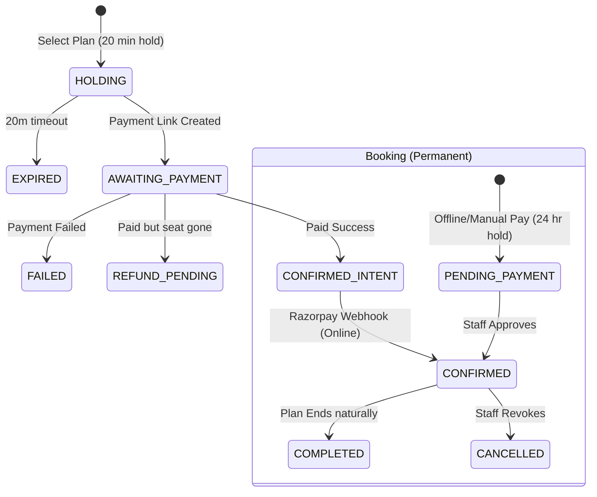

# FocusDesk Product Requirements Document (PRD)

**Last verified against commit**: `90c4b5a1700d3f5308086aa1f42f8f9dff5289ee`

## Overview
FocusDesk is a comprehensive library and study space management platform. It combines a Next.js web application with custom ESP32 hardware to enable automated seat booking, subscription management, and physical access control.
*Read the detailed breakdown: [00-discovery.md](00-discovery.md)*

## Problem and Goals (Inferred)
* **Problem**: Libraries struggle to monetize premium seating, track accurate patron attendance, and enforce plan limits without heavy manual reception work.
* **Goal**: Automate access using dynamic QR codes and physical scanners, enforce business rules automatically (overstay tracking, auto-checkout), and provide a self-serve portal for patrons.

## Users and Roles
1. **Patrons (Students)**: Book seats and scan to enter.
2. **Librarians**: Manage their specific library, approve payments, and monitor attendance.
3. **Receptionists**: Staff the front desk for a specific library.
4. **Admins**: Superusers with global oversight.
*Read detailed journeys: [01-users-and-journeys.md](01-users-and-journeys.md)*

## Features and Requirements
FocusDesk encompasses 20 core features.
* **Feature Inventory**: [02-feature-inventory.md](02-feature-inventory.md)
* **Core Requirements**: [03a-functional-requirements-core.md](03a-functional-requirements-core.md)
* **Operations Requirements**: [03b-functional-requirements-ops.md](03b-functional-requirements-ops.md)

### Booking Lifecycle

## Data and Privacy
FocusDesk collects PII (phone, Aadhaar info, physical logs), persisting them indefinitely in PostgreSQL.
*Read data flows: [04-data-and-privacy.md](04-data-and-privacy.md)*

## How It Works (For Non-Engineers)
The platform uses a Next.js monolith. Real-time updates push directly to the dashboard via Supabase. Hardware interacts with the DB to physically unlock doors.
*Read the plain-language dev walkthrough: [05-how-it-works.md](05-how-it-works.md)*

## Non-Functional Requirements
The system is performant (Vercel, Redis rate-limiting) and uses strict transactional reliability for bookings, but lacks data purging and PII encryption.
*Read the full NFR assessment: [06-non-functional.md](06-non-functional.md)*

## Gaps, Risks, and Roadmap
The primary risk is the unencrypted storage of Aadhaar and physical entry PII.
*Read the full roadmap: [07-gaps-and-roadmap.md](07-gaps-and-roadmap.md)*

## Open Questions for Founders
1. Do we offer a 1-hour grace period for offline manual payments?
2. How should we handle PII purging for patrons who delete their accounts?
3. Should we enforce strict hardware locks if Razorpay payments are in HOLDING state?
4. Do we plan to expand `walletBalance` feature or remove it entirely?

## Open Questions
- Should offline "Pay at Reception" bookings grant a 1-hour grace period for entry before approval?
- How do we handle PII purging for patrons who delete their accounts?

## Glossary & Coverage
* [Glossary](glossary.md)
* [Coverage](COVERAGE.md)
